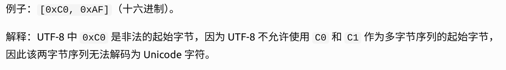

[^1]: 完整列表见 pytorch.org/docs/stable/nn.html#containers。
    
# CS336 作业一（基础篇）：从零构建 Transformer 语言模型

> **原文**：CS336 Assignment 1 (basics): Building a Transformer LM
> **版本**：Version 26.0.3 ｜ **学期**：Spring 2026 ｜ **作者**：CS336 Staff
> **来源**：`github.com/stanford-cs336/assignment1-basics`
> **说明**：本文件为原文的中文翻译整理版。术语首次出现时保留英文原词（如 tokenizer、residual stream），公式统一改写为 LaTeX，题目（Problem）按"交付物 / 考察点"重排为统一结构。原文图片（Figure 1–3）以文字化结构图替代说明。

---

## 目录

- [1 作业总览](#1-作业总览)
- [2 字节对编码（BPE）分词器](#2-字节对编码bpe分词器)
  - [2.1 Unicode 标准](#21-unicode-标准) ｜ [2.2 Unicode 编码](#22-unicode-编码) ｜ [2.3 子词分词](#23-子词分词)
  - [2.4 BPE 分词器训练](#24-bpe-分词器训练) ｜ [2.5 BPE 训练实验](#25-bpe-分词器训练实验) ｜ [2.6 编码与解码](#26-bpe-分词器编码与解码) ｜ [2.7 实验](#27-实验)
- [3 Transformer 语言模型结构](#3-transformer-语言模型结构)
  - [3.1 Transformer LM](#31-transformer-lm) ｜ [3.2 批处理与 Einsum](#32-附注批处理einsum-与高效计算) ｜ [3.3 Linear 与 Embedding](#33-基本构件linear-与-embedding-模块)
  - [3.4 Pre-Norm Transformer Block](#34-pre-norm-transformer-块) ｜ [3.5 完整 Transformer LM](#35-完整的-transformer-lm)
- [4 训练 Transformer LM](#4-训练-transformer-lm)
  - [4.1 交叉熵损失](#41-交叉熵损失) ｜ [4.2 SGD](#42-sgd-优化器) ｜ [4.3 AdamW](#43-adamw) ｜ [4.4 学习率调度](#44-学习率调度) ｜ [4.5 梯度裁剪](#45-梯度裁剪)
- [5 训练循环](#5-训练循环)
- [6 生成文本](#6-生成文本)
- [7 实验](#7-实验)
- [附录 A：全部题目与分值速查表](#附录-a全部题目与分值速查表)
- [参考文献](#参考文献)

---

## 1 作业总览

在本作业中，你将从零构建训练一个标准 Transformer 语言模型（LM）所需的全部组件，并实际训练若干模型。

### 1.1 你将实现什么

1. 字节对编码（BPE）分词器（第 2 节）
2. Transformer 语言模型（第 3 节）
3. 交叉熵损失函数与 AdamW 优化器（第 4 节）
4. 训练循环，支持模型与优化器状态的序列化与加载（第 5 节）

### 1.2 你将运行什么

1. 在 TinyStories 数据集上训练 BPE 分词器。
2. 用训练好的分词器对数据集做编码，转换成整数 ID 序列。
3. 在 TinyStories 上训练 Transformer LM。
4. 用训练好的 Transformer LM 做采样生成，并评估困惑度（perplexity）。
5. 在 OpenWebText 上训练模型，并将得到的困惑度提交到排行榜。

### 1.3 你可以使用什么

我们期望你从零构建每个组件。**特别地，除下列内容外，你不得使用 `torch.nn`、`torch.nn.functional` 或 `torch.optim` 中的任何定义：**

- `torch.nn.Parameter`
- `torch.nn` 中的容器类（例如 `Module`、`ModuleList`、`Sequential` 等）[^1]
- `torch.optim.Optimizer` 基类

其他 PyTorch 定义都可以使用。如果你想用某个函数或类但不确定是否被允许，欢迎在 Slack 上提问。拿不准时，请先考虑：使用它是否会损害本作业"从零实现"（from-scratch）的初衷。

### 1.4 关于 AI 工具的声明

AI 可以完全自主地解决作业的许多部分，这会让人更难深入投入课程材料并从中学习。

AI 工具**允许**用于回答高层概念性问题，或提供底层编程文档（如函数签名、库 API）。但 AI 工具**不允许**用于实现作业的任何部分——这既包括编程智能体（如 Cursor Agents、Codex、Claude Code），也包括 AI 自动补全（如 Cursor Tab、GitHub Copilot）。使用 AI 智能体时，务必让它使用所提供的 `AGENTS.md` 文件；使用聊天机器人时也应把题目一并贴入。

我们强烈建议在完成作业时**关闭 IDE 中的 AI 自动补全**（非 AI 的补全，例如补全函数名，完全没有问题）。往届学生反馈，关闭 AI 自动补全让他们更容易深入理解材料。

完整 AI 政策见官方文档。

### 1.5 代码结构

作业代码与本讲义均托管于 GitHub：

```
github.com/stanford-cs336/assignment1-basics
```

请 `git clone` 该仓库。若有更新我们会通知你，届时 `git pull` 获取最新版本。

1. `cs336_basics/*`：你写代码的地方。注意这里本来没有任何代码——你可以从零自由发挥。
2. `adapters.py`：你的代码必须具备的一组功能。对每个功能（例如 scaled dot product attention），通过调用你自己的代码实现对应函数（例如 `run_scaled_dot_product_attention`）。**注意：你对 `adapters.py` 的修改不应包含任何实质性逻辑，这只是胶水代码。**
3. `test_*.py`：包含你必须通过的全部测试（例如 `test_scaled_dot_product_attention`），它们会调用 `adapters.py` 中定义的钩子。**不要修改测试文件。**

### 1.6 如何提交

运行 `make_submission.sh` 生成提交用的 zip 包。如果你有大体积数据文件或 checkpoint 不想打包，请记得把它们加入脚本的排除列表。

你需要向 Gradescope 提交：

- `writeup.pdf`：回答所有书面问题，请使用排版工具（不要手写截图）。
- `code.zip`：包含你写的全部代码。

提交到排行榜：向以下仓库发起 PR：

```
github.com/stanford-cs336/assignment1-basics-leaderboard
```

详细提交说明见排行榜仓库的 `README.md`。

### 1.7 数据集从哪来

本作业使用两个预处理好的数据集：**TinyStories**（R. Eldan et al., 2023）与 **OpenWebText**（A. Gokaslan et al., 2019）。两者都是单个大型纯文本文件。

- 若你随课程学习，可在 compute guide 中找到数据集下载说明。
- 若你自学，可通过 `README.md` 中的命令下载。

> **低资源提示：总述**
>
> 在本课程所有作业讲义中，我们都会给出"用更少甚至没有 GPU 资源"完成作业某部分的建议。例如，我们有时会建议缩小数据集或模型规模，或说明如何在 Mac 集成显卡或 CPU 上运行训练代码。这些"低资源提示"会放在**蓝色提示框**中（就像本框）。即便你是有课程机器权限的斯坦福在校生，这些技巧也能帮你更快迭代、省下时间，建议阅读。

> **低资源提示：在 Apple Silicon 或 CPU 上做作业一**
>
> 使用官方参考答案代码，我们可以在 36 GB 内存的 Apple M4 Max 芯片上训练出一个能生成相当流畅文本的 LM：Metal GPU（MPS）下不到 5 分钟，CPU 下约 30 分钟。如果这些词对你没什么意义也不用担心——只需知道，只要你的笔记本还算新、实现正确且高效，你就能训练出一个小 LM，生成质量尚可的简单儿童故事。
>
> 作业后文会说明在 CPU 或 MPS 上需要做哪些改动。

---

## 2 字节对编码（BPE）分词器

作业第一部分，我们将训练并实现一个**字节级**字节对编码（byte-level BPE）分词器（R. Sennrich et al., 2016；C. Wang et al., 2019）。具体来说，我们把任意（Unicode）字符串表示为字节序列，并在这条字节序列上训练 BPE 分词器。之后用该分词器把文本（字符串）编码为 tokens（整数序列），供语言模型使用。

### 2.1 Unicode 标准

Unicode 是一种文本编码标准，把字符映射到整数**码点**（code point）。截至 Unicode 17.0（2025 年 9 月发布），该标准在 172 个文字系统中定义了 159,801 个字符。例如字符 `"s"` 的码点是 115（通常写作 U+0073，其中 U+ 是约定前缀，0073 是 115 的十六进制），字符 `"牛"` 的码点是 29275。

在 Python 中，可用 `ord()` 把单个 Unicode 字符转成整数表示，用 `chr()` 把整数码点转成对应字符的字符串：

```python
>>> ord('牛')
29275
>>> chr(29275)
'牛'
```

> **题目（unicode1）：理解 Unicode（1 分）**
>
> **(a)** `chr(0)` 返回什么 Unicode 字符？
> *交付物*：一句话回答。
> '\x00'
>
> **(b)** 该字符的字符串表示（`__repr__()`）与打印表示有什么不同？
> *交付物*：一句话回答。
> 直接打印chr（0）返回空白，repr打印可以返回内存地址
> `repr()` 将不可见的 NULL 字符显示成 `x00<`
>
> **(c)** 当该字符出现在文本中会发生什么？可以试着在 Python 解释器中运行以下代码，看结果是否符合预期：
>
> ```python
>>>> chr(0)
>>>> print(chr(0))
>>>> "this is a test" + chr(0) + "string"
>>>> print("this is a test" + chr(0) + "string")
> ```
>
> *交付物*：一句话回答。

### 2.2 Unicode 编码

Unicode 标准定义了字符到码点（整数）的映射，但直接在码点上训练分词器并不现实：词表会大到难以承受（约 150K 项）且极其稀疏（很多字符非常罕见）。因此我们使用 **Unicode 编码**，把 Unicode 字符转换成字节序列。Unicode 标准本身定义了三种编码：UTF-8、UTF-16、UTF-32，其中 UTF-8 是互联网上的主导编码（超过 98% 的网页）。

用 Python 的 `encode()` 可把 Unicode 字符串编码为 UTF-8；要访问 `bytes` 对象的底层字节值，可以迭代它（例如 `list()`）；最后用 `decode()` 把 UTF-8 字节串解码回 Unicode 字符串。

```python
>>> test_string = "hello! こんにちは!"
>>> utf8_encoded = test_string.encode("utf-8")
>>> print(utf8_encoded)
b'hello! \xe3\x81\x93\xe3\x82\x93\xe3\x81\xab\xe3\x81\xa1\xe3\x81\xaf!'
>>> print(type(utf8_encoded))
<class 'bytes'>
>>> # 获取编码后字符串的字节值（0 到 255 的整数）
>>> list(utf8_encoded)
[104, 101, 108, 108, 111, 33, 32, 227, 129, 147, 227, 130, 147, 227, 129, 171, 227, 129,
161, 227, 129, 175, 33]
>>> # 一个字节不一定对应一个 Unicode 字符！
>>> print(len(test_string))
13
>>> print(len(utf8_encoded))
23
>>> print(utf8_encoded.decode("utf-8"))
hello! こんにちは!
```

通过把 Unicode 码点转换为字节序列（例如经 UTF-8），我们实际上是把一串码点（21 位整数、159,801 个有效值）变换为字节值序列（0 到 255 的整数）。长度为 256 的字节词表好处理得多。使用字节级分词时，我们不必担心 out-of-vocabulary（词表外）token，因为任何输入文本都能表示为 0 到 255 的整数序列。

> **题目（unicode2）：Unicode 编码（3 分）**
>
> **(a)** 为什么应当优先在 UTF-8 编码的字节上训练分词器，而不是 UTF-16 或 UTF-32？对比几种编码在不同输入字符串上的输出会有帮助。
> *交付物*：1–2 句话回答。
> UTF编码的字节构成了当今互联网上98%的语料，这样训练出来的分词器，解码语料更加的方便。
> UTF-8 使用 1–4 个字节表示一个 Unicode 字符，ASCII 字符只占 1 字节，因此英文、数字和常见文本更加节省空间；UTF-16 通常至少占 2 字节，UTF-32 则固定占 4 字节。更重要的是，UTF-8 能直接以字节（0–255）作为分词器的基础词汇表，既节省存储空间，又能统一处理各种语言和特殊字符，避免 UTF-16/32 的额外编码复杂性。
>
> **(b)** 下面这个（错误的）函数本意是把 UTF-8 字节串解码为 Unicode 字符串。它为什么是错的？给出一个会产生错误结果的输入字节串。
>
> ```python
> def decode_utf8_bytes_to_str_wrong(bytestring: bytes):
>     return "".join([bytes([b]).decode("utf-8") for b in bytestring])
>
>>>> decode_utf8_bytes_to_str_wrong("hello".encode("utf-8"))
> 'hello'
> ```
>
> *交付物*：一个会令该函数输出错误的输入字节串，并用一句话解释错因。
> 在UNicode中英文字母通常只需要一个字节表示，但中文字符通常需要三字节，因此在使用单个字节遍历输出的时候，中文字符就会断裂，因而报错。
>
> **(c)** 给出一个无法解码为任何 Unicode 字符的**两字节**序列。
> *交付物*：一个例子，加一句话解释。
>
> 

### 2.3 子词分词

字节级分词能缓解词级分词器面临的词表外问题，但把文本切成字节会导致输入序列极长。这会拖慢模型训练：一个 10 个词的句子在词级 LM 中可能只有 10 个 token，在字符级模型中却可能有 50 个以上 token（取决于单词长度）。处理更长的序列意味着模型每一步的计算量更大；此外，在字节序列上做语言建模也更困难，因为更长的输入序列会在数据中制造长期依赖。

**子词分词**是词级与字节级之间的折中。注意字节级分词器的词表有 256 项（字节值 0–255）。子词分词器用更大的词表换取对输入字节序列更好的压缩。例如，如果字节序列 `b'the'` 在原始训练文本中经常出现，把它加入词表就能把 3 个 token 的序列压缩成 1 个 token。

如何选择加入词表的子词单元？R. Sennrich et al. [3] 提出使用**字节对编码**（BPE；P. Gage [5]）：一种压缩算法，迭代地把最频繁的字节对替换（"合并"）为一个新的、未被使用的索引。注意该算法向词表添加子词 token 的目标是最大化对输入序列的压缩——如果某个词在输入文本中出现得足够多，它就会被表示为单个子词单元。

用 BPE 构造词表的子词分词器通常称为 **BPE 分词器**。本作业中我们将实现字节级 BPE 分词器，词表项是字节或合并后的字节序列，这样在"词表外处理"和"可接受的输入序列长度"两方面都能兼得。构造 BPE 词表的过程称为 BPE 分词器的**训练**。

### 2.4 BPE 分词器训练

BPE 分词器训练包含三个主要步骤。

#### 词表初始化

分词器词表是"字节串 token → 整数 ID"的一一映射。由于训练的是字节级 BPE，初始词表就是全部字节的集合。字节值有 256 种，因此初始词表大小为 256。

#### 预分词（Pre-tokenization）

有了词表之后，原则上你可以直接统计文本中相邻字节的出现频率，然后从最频繁的字节对开始合并。但这在计算上非常昂贵，因为每做一次合并都要完整遍历一遍语料。此外，直接在语料上跨词合并字节，可能产生仅标点不同的 token（例如 `dog!` 与 `dog.`）。这些 token 会得到完全不同的 ID，尽管它们在语义上高度相似（只差一个标点）。

为避免这个问题，我们先对语料做**预分词**。可以把它理解为对语料的一次粗粒度分词，帮助我们统计字符对的出现频率。例如单词 `'text'` 可能作为预分词出现 10 次；此时统计字符 `t` 与 `e` 相邻的次数时，我们只需看到 `'text'` 内部 `t` 与 `e` 相邻，就把它们的计数加 10，而不必扫描整个语料。由于训练的是字节级 BPE，每个预分词都表示为 UTF-8 字节序列。

R. Sennrich et al. [3] 的原始 BPE 实现只按空白切分（即 `s.split(" ")`）。这种方法仍见于基于 SentencePiece 的分词器（例如 Llama 1 和 2 的分词器）。

多数现代分词器使用**基于正则**的预分词器，这是源自 GPT-2 的做法（A. Radford et al. [6]）。我们使用原始正则的一个更漂亮的形式，取自 `github.com/openai/tiktoken/pull/234/files`：

```python
>>> PAT = r"""'(?:[sdmt]|ll|ve|re)| ?\p{L}+| ?\p{N}+| ?[^\s\p{L}\p{N}]+|\s+(?!\S)|\s+"""
```

用这个预分词器交互式地切一些文本，有助于理解它的行为：

```python
>>> # 需要 `regex` 包
>>> import regex as re
>>> re.findall(PAT, "some text that i'll pre-tokenize")
['some', ' text', ' that', ' i', "'ll", ' pre', '-', 'tokenize']
```

不过在代码中使用时，你应使用 `re.finditer`，以免在构建"预分词 → 计数"映射时把所有切分结果都存下来。

#### 计算 BPE 合并

现在输入文本已经变成预分词、且每个预分词都是 UTF-8 字节序列，可以计算 BPE 合并（即训练 BPE 分词器）了。高层看，BPE 算法迭代地统计每一对字节，找出频率最高的一对（"A"、"B"），然后把所有出现的（"A","B"）替换为新 token "AB"。这个新合并的 token 加入词表；因此 BPE 训练结束后的最终词表大小 = 初始词表大小（本作业为 256）+ 训练期间执行的合并次数。

为效率起见，BPE 训练时**不考虑跨越预分词边界的字节对**[^2]。计算合并时，对频率并列的情况做确定性处理：**优先选择字典序更大的一对**。例如 ("A","B")、("A","C")、("B","ZZ")、("BA","A") 频率并列最高时，我们合并 ("BA","A")：

```python
>>> max([("A", "B"), ("A", "C"), ("B", "ZZ"), ("BA", "A")])
('BA', 'A')
```

#### 特殊 token

有些字符串（例如 `<|endoftext|>`）常用于编码元信息（例如文档边界）。编码文本时，往往希望把某些字符串视为"特殊 token"，即**永不**被切成多个 token（始终保留为单个 token）。例如序列结束串 `<|endoftext|>` 应始终保持为单个 token（单个整数 ID），这样我们才知道何时停止从 LM 生成。这些特殊 token 必须加入词表，从而拥有固定的 token ID。

R. Sennrich et al. [3] 的 Algorithm 1 包含一个低效的 BPE 训练实现（基本就是上面列出的步骤）。作为第一个练习，实现并测试它有助于检验你的理解。

> **示例（bpe_example）：BPE 训练示例**
>
> 这是 R. Sennrich et al. [3] 中一个风格化的例子。考虑由以下文本构成的语料：
>
> ```
> low low low low low
> lower lower widest widest widest
> newest newest newest newest newest newest
> ```
>
> 词表中含一个特殊 token `<|endoftext|>`。
>
> **词表**
> 用特殊 token `<|endoftext|>` 与 256 个字节值初始化词表。
>
> **预分词**
> 为简化并聚焦合并过程，本例假设预分词只按空白切分。预分词并计数后得到频率表：
>
> ```
> {low: 5, lower: 2, widest: 3, newest: 6}
> ```
>
> 方便起见将其表示为 `dict[tuple[bytes, ...], int]`，例如 `{(l,o,w): 5, …}`。注意在 Python 中单个字节也是 `bytes` 对象——Python 没有表示"单个字节"的 `byte` 类型，正如没有表示"单个字符"的 `char` 类型。
>
> **合并**
> 首先考察每对相邻字节，把它们所在词的频次相加：
> `{lo: 7, ow: 7, we: 8, er: 2, wi: 3, id: 3, de: 3, es: 9, st: 9, ne: 6, ew: 6}`。
> 其中 (`e`,`s`) 与 (`s`,`t`) 并列，取字典序更大者 (`s`,`t`)。合并后：
> `{(l,o,w): 5, (l,o,w,e,r): 2, (w,i,d,e,st): 3, (n,e,w,e,st): 6}`。
>
> 第二轮中最频繁的是 (`e`,`st`)（计数 9），合并后：
> `{(l,o,w): 5, (l,o,w,e,r): 2, (w,i,d,est): 3, (n,e,w,est): 6}`。
> 继续下去，最终得到的合并序列为
> `['s t', 'e st', 'o w', 'l ow', 'w est', 'n e', 'ne west', 'w i', 'wi d', 'wid est', 'low e', 'lowe r']`。
>
> 若只取前 6 次合并，即 `['s t', 'e st', 'o w', 'l ow', 'w est', 'n e']`，词表元素为
> `[<|endoftext|>, [...256 个字节字符], st, est, ow, low, west, ne]`。
>
> 用这个词表与合并集合，词 `newest` 会被分词为 `[ne, west]`。

### 2.5 BPE 分词器训练实验

现在在 TinyStories 数据集上训练一个字节级 BPE 分词器。数据集查找/下载方式见第 1 节。开始前建议先看一眼 TinyStories，对数据内容有直观印象。

#### 并行化预分词

你会发现预分词步骤是主要瓶颈。可以用内置库 `multiprocessing` 并行化来加速。具体建议：并行实现预分词时，对语料分块（chunk），但**确保分块边界落在特殊 token 的起始处**。你可以直接照抄下面链接中的起始代码来获得分块边界，再把工作分发到各进程：

```
https://github.com/stanford-cs336/assignment1-basics/blob/main/cs336_basics/pretokenization_example.py
```

这种分块方式总是有效的，因为我们从不希望跨文档边界合并。就本作业而言，你始终可以这样切分。不必担心"语料中完全不含 `<|endoftext|>`"这种边缘情况。

#### 预分词前移除特殊 token

在用正则（`re.finditer`）运行预分词之前，应先从语料（若并行则在各分块）中**剔除所有特殊 token**。务必在特殊 token 处切分，使它们所界定的文本之间不会发生合并。例如语料（或分块）为 `[Doc 1]<|endoftext|>[Doc 2]`，你应在 `<|endoftext|>` 处切分，分别对 `[Doc 1]` 与 `[Doc 2]` 做预分词，这样文档边界处不会发生合并。换言之，**训练时特殊 token 定义硬分割边界，但它们本身不应计入合并统计**。这可以用 `re.split` 实现，分隔符为 `"|".join(special_tokens)`（注意用 `re.escape`，因为特殊 token 中可能含有 `|`）。测试 `test_train_bpe_special_tokens` 会检验这一点。

#### 优化合并步骤

上面风格化示例中的朴素 BPE 训练实现很慢，因为每次合并都要遍历所有字节对来找出最频繁的一对。但实际上，每次合并后只有与 **被合并对相邻/重叠**的配对计数会变化。因此可以通过索引所有配对的计数并**增量更新**，而不是显式遍历计数，来显著提速。这个缓存技巧能带来可观的加速；不过要注意，BPE 训练中的合并部分在 Python 里无法并行化。

> **低资源提示：性能剖析**
>
> 应使用 `cProfile` 或 `py-spy` 等剖析工具定位实现中的瓶颈，并集中优化这些部分。

> **低资源提示："降规模"（Downscaling）**
>
> 不要一上来就在完整的 TinyStories 上训练分词器，建议先用一个小数据子集（"调试数据集"）训练。例如可以改用 TinyStories 的验证集，它只有 22K 篇文档而不是 2.12M 篇。这体现了一个通用策略：能降规模就降规模以加快开发（例如更小的数据集、更小的模型）。
>
> 调试集或超参配置的规模选择需要仔细权衡：调试集要**大到足以复现完整配置下的同样瓶颈**（这样你做的优化才能泛化），但又不能大到跑不完。

> **题目（train_bpe）：BPE 分词器训练（15 分）**
>
> *交付物*：写一个函数，给定输入文本文件路径，训练一个（字节级）BPE 分词器。你的 BPE 训练函数至少应处理以下输入参数：
>
> **输入**
>
> | 参数               | 类型          | 说明                                                                                     |
> | ------------------ | ------------- | ---------------------------------------------------------------------------------------- |
> | `input_path`     | `str`       | BPE 训练数据文本文件路径                                                                 |
> | `vocab_size`     | `int`       | 正整数，定义最终词表大小上限（包含初始字节词表、合并产生的词表项，以及所有特殊 token）   |
> | `special_tokens` | `list[str]` | 要加入词表的字符串列表。训练时把它们视为硬边界，阻止跨其跨度合并；但不把它们计入合并统计 |
>
> 函数应返回得到的词表与合并列表：
>
> **输出**
>
> | 返回值     | 类型                          | 说明                                                                                                                   |
> | ---------- | ----------------------------- | ---------------------------------------------------------------------------------------------------------------------- |
> | `vocab`  | `dict[int, bytes]`          | 分词器词表，从 int（词表中 token ID）映射到 bytes（token 字节）                                                        |
> | `merges` | `list[tuple[bytes, bytes]]` | 训练产生的 BPE 合并列表。每项是 `(<token1>, <token2>)`，表示 `<token1>` 与 `<token2>` 被合并。列表按创建顺序排列 |
>
> 要用我们提供的测试验证你的 BPE 训练函数，需先实现测试适配器 `[adapters.run_train_bpe]`，然后运行 `uv run pytest tests/test_train_bpe.py`，你的实现应能通过全部测试。
>
> 可选（可能需要大量时间投入）：用系统级语言实现训练方法的若干关键部分，例如 C++（可考虑 `cppyy` 或 `nanobind`）或 Rust（用 `PyO3`）。若这样做，需注意哪些操作需要拷贝、哪些可直接读取 Python 内存，并留下构建说明，或确保仅靠 `pyproject.toml` 即可构建。另外注意：GPT-2 正则不被多数正则引擎良好支持，且多数引擎下过慢。我们验证过 Oniguruma 速度尚可且支持负向前瞻，但 Python 的 `regex` 包如果要说的话还要更快。

> **题目（train_bpe_tinystories）：在 TinyStories 上训练 BPE（2 分）**
>
> **(a)** 在 TinyStories 数据集上训练字节级 BPE 分词器，最大词表大小为 10,000，记得把 TinyStories 的 `<|endoftext|>` 特殊 token 加入词表。把得到的词表与合并序列化到磁盘以便进一步检查。训练花了多少时间与内存？词表中最长的 token 是什么？它合理吗？
> *资源要求*：≤ 30 分钟（无 GPU），≤ 30 GB RAM
>
>> **提示**：若在预分词阶段使用多进程，并利用下面两个事实，BPE 训练应能控制在 2 分钟以内：
>> (a) `<|endoftext|>` token 在数据文件中分隔文档；(b) `<|endoftext|>` 在应用 BPE 合并前作为特殊情况处理。
>>
>
> *交付物*：1–2 句话回答。
>
> **(b)** 剖析你的代码。分词器训练过程中哪一部分最耗时？
> *交付物*：1–2 句话回答。

接下来，我们尝试在 OpenWebText 数据集上训练字节级 BPE 分词器。同样建议先看看数据集，理解其内容。

> **题目（train_bpe_expts_owt）：在 OpenWebText 上训练 BPE（2 分）**
>
> **(a)** 在 OpenWebText 上训练字节级 BPE 分词器，最大词表 32,000。把词表与合并序列化到磁盘以便检查。词表中最长的 token 是什么？它合理吗？
> *资源要求*：≤ 12 小时（无 GPU），≤ 100 GB RAM
> *交付物*：1–2 句话回答。
>
> **(b)** 比较并对比在 TinyStories 与 OpenWebText 上训练得到的分词器。
> *交付物*：1–2 句话回答。

### 2.6 BPE 分词器：编码与解码

上一部分我们实现了在输入文本上训练 BPE 分词器、得到词表与合并列表的函数。现在我们实现一个 BPE 分词器：加载给定的词表与合并列表，用它们把文本编码为 token ID、把 token ID 解码为文本。

#### 2.6.1 编码文本

用 BPE 编码文本的过程与训练 BPE 词表的过程相呼应，主要步骤如下。

**步骤 1：预分词。** 先对序列做预分词，并把每个预分词表示为 UTF-8 字节序列，与 BPE 训练时相同。接下来在每个预分词**内部**把字节合并为词表元素，各预分词独立处理（不跨预分词边界合并）。

**步骤 2：应用合并。** 取训练期间生成的词表元素合并序列，按**创建顺序**依次应用到预分词上。

> **示例（bpe_encoding）：BPE 编码示例**
>
> 设输入字符串为 `'the cat ate'`，词表为
> `{0: b' ', 1: b'a', 2: b'c', 3: b'e', 4: b'h', 5: b't', 6: b'th', 7: b' c', 8: b' a', 9: b'the', 10: b' at'}`，
> 学到的合并为 `[(b't', b'h'), (b' ', b'c'), (b' ', b'a'), (b'th', b'e'), (b' a', b't')]`。预分词器会先把字符串切成 `['the', ' cat', ' ate']`，再对每个预分词应用 BPE 合并。
>
> 第一个预分词 `'the'` 初始表示为 `[b't', b'h', b'e']`。按合并列表检查，第一个适用的合并是 `(b't', b'h')`，于是变为 `[b'th', b'e']`；再回到列表，下一个适用的是 `(b'th', b'e')`，变为 `[b'the']`；此后没有适用的合并了（整个预分词已合并为单个 token），结束。对应整数序列为 `[9]`。
>
> 对剩余预分词重复该过程：`' cat'` 应用合并后为 `[b' c', b'a', b't']`，即整数序列 `[7, 1, 5]`；`' ate'` 应用合并后为 `[b' at', b'e']`，即 `[10, 3]`。最终编码结果为 `[9, 7, 1, 5, 10, 3]`。

#### 特殊 token

编码文本时，你的分词器应能正确处理用户定义的特殊 token（在构造分词器时提供）。

#### 内存考量

假设要分词一个无法整体装入内存的大文本文件。为了高效地分词这个文件（或任何数据流），需要把它切成可管理的块并逐块处理，使内存复杂度为**常数**而不是随文本大小线性增长。这样做时必须确保 token **不跨越块边界**，否则得到的分词结果会与"整个序列读入内存后一次性分词"的朴素方法不同。

#### 2.6.2 解码文本

要把整数 token ID 序列解码回原始文本，只需查每个 ID 在词表中对应的项（字节序列）、拼接起来，再把字节解码为 Unicode 字符串。注意输入 ID 不保证映射到合法 Unicode 字符串（用户可以输入任意整数 ID 序列）。当输入 token ID 无法产生合法 Unicode 字符串时，应把畸形字节替换为官方 Unicode 替换字符 **U+FFFD**[^3]。`bytes.decode` 的 `errors` 参数控制 Unicode 解码错误的处理方式，使用 `errors='replace'` 会自动把畸形数据替换为替换标记。

> **题目（tokenizer）：实现分词器（15 分）**
>
> *交付物*：实现一个 `Tokenizer` 类，给定词表与合并列表，把文本编码为整数 ID、把整数 ID 解码为文本。分词器还应支持用户提供的特殊 token（若不在词表中则追加）。推荐接口如下：
>
> ```python
> def __init__(self, vocab, merges, special_tokens=None)
> ```
>
> 由给定词表、合并列表与（可选的）特殊 token 列表构造分词器。参数：
>
> - `vocab: dict[int, bytes]`
> - `merges: list[tuple[bytes, bytes]]`
> - `special_tokens: list[str] | None = None`
>
> ```python
> @classmethod
> def from_files(cls, vocab_filepath, merges_filepath, special_tokens=None)
> ```
>
> 由序列化的词表与合并列表（格式同你的 BPE 训练代码输出）以及（可选的）特殊 token 列表构造并返回 `Tokenizer`。附加参数：
>
> - `vocab_filepath: str`
> - `merges_filepath: str`
> - `special_tokens: list[str] | None = None`
>
> ```python
> def encode(self, text: str) -> list[int]
> ```
>
> 把输入文本编码为 token ID 序列。
>
> ```python
> def encode_iterable(self, iterable: Iterable[str]) -> Iterator[int]
> ```
>
> 给定字符串的可迭代对象（例如 Python 文件句柄），返回一个惰性产出 token ID 的生成器。这是对无法直接读入内存的大文件做内存高效分词的必需能力。
>
> ```python
> def decode(self, ids: list[int]) -> str
> ```
>
> 把 token ID 序列解码为文本。
>
> 要用我们提供的测试验证，需先实现测试适配器 `[adapters.get_tokenizer]`，然后运行 `uv run pytest tests/test_tokenizer.py`，你的实现应能通过全部测试。

### 2.7 实验

> **题目（tokenizer_experiments）：分词器实验（4 分）**
>
> **(a)** 从 TinyStories 与 OpenWebText 各采样 10 篇文档。用你此前训练的 TinyStories 与 OpenWebText 分词器（词表分别为 10K 与 32K）把这些文档编码为整数 ID。各分词器的压缩率（bytes/token）是多少？
> *交付物*：1–2 句话回答。
>
> **(b)** 若用 TinyStories 分词器去分词 OpenWebText 样本会怎样？比较压缩率，和/或定性描述发生了什么。
> *交付物*：1–2 句话回答。
>
> **(c)** 估算分词器的吞吐（例如 bytes/second）。分词 Pile 数据集（825GB 文本）需要多久？
> *交付物*：1–2 句话回答。
>
> **(d)** 用你的 TinyStories 与 OpenWebText 分词器，分别把对应的训练集与验证集编码为整数 token ID 序列。后续训练语言模型会用到。建议把 token ID 序列化为 `uint16` 的 NumPy 数组。为什么 `uint16` 是合适的选择？
> *交付物*：1–2 句话回答。

---

## 3 Transformer 语言模型结构

语言模型接收一批整数 token ID 序列（即形状为 `(batch_size, sequence_length)` 的 `torch.Tensor`），返回词表上的（批）归一化概率分布（即形状 `(batch_size, sequence_length, vocab_size)` 的 PyTorch Tensor），其中每个位置的预测分布是"下一个词"的分布。训练时我们用这些下一词预测计算真实下一词与预测之间的交叉熵损失；推理时从语言模型生成文本，我们取最后时间步（序列最后一项）的下一词分布来生成序列中的下一个 token（例如取概率最大的 token、按分布采样等），把生成的 token 追加到输入序列，重复该过程。

本节你将亲手构建这个 Transformer 语言模型。我们先给出模型的高层描述，再逐步细化各个组件。

### 3.1 Transformer LM

给定 token ID 序列，Transformer LM 用**输入嵌入**把 token ID 转成稠密向量，把嵌入后的 token 依次通过 `num_layers` 个 Transformer 块，再施加一个可学习的线性投影（"输出嵌入"或"LM head"）得到下一 token 的 logits。

```text
                    输出概率 (batch_size, seq_len, vocab_size)
                                  ▲
                              Softmax
                                  ▲
                        Linear（输出嵌入 / LM head）
                                  ▲
                                Norm            ← 最终 RMSNorm
                                  ▲
        ┌──────────────  num_layers 个 ──────────────┐
        │            Transformer Block              │
        │   x ─► Norm ─► 因果多头自注意力(带 RoPE) ─► + ─┐
        │   └──────────────────────────────────────────┘ │
        │   z ─► Norm ─► SwiGLU 逐位置前馈 ──────────► + ─┐
        │   └──────────────────────────────────────────┘ │
        └───────────────────────────────────────────────┘
                                  ▲
                         Token Embedding
                                  ▲
                    输入 (batch_size, seq_len)
```

**图 1**：Transformer 语言模型总览。

```text
        z = x + MultiHeadSelfAttention(RMSNorm(x))
        y = z + FFN(RMSNorm(z))          ← pre-norm：先归一化，再进子层
```

**图 2**：Pre-norm Transformer 块（残差连接跨越每个子层）。

#### Token 嵌入

第一步，Transformer 把（批）token ID 序列嵌入为携带 token 身份信息的向量序列（图 1 中的红色块）。具体地，给定 token ID 序列，模型使用 token 嵌入层产生向量序列：该层输入形状 `(batch_size, sequence_length)` 的整数张量，输出形状 `(batch_size, sequence_length, d_model)` 的向量序列。

#### Pre-norm Transformer 块

嵌入之后，激活值经过若干结构相同的神经网络层。标准 decoder-only Transformer LM 由 `num_layers` 个相同层（通常称为 Transformer "块"）组成。每个块输入形状 `(batch_size, sequence_length, d_model)`，输出同形状。每个块通过自注意力在序列维度聚合信息，并通过前馈层做非线性变换。

经过 `num_layers` 个块后，我们把最终激活值转换为词表上的分布。

我们将实现 **pre-norm** Transformer 块（详见 3.4 节），它额外要求在最后一个块**之后**再做一次层归一化，以确保输出被正确缩放。

归一化之后，用标准的可学习线性变换把块的输出转成下一 token 的预测 logits（参见 A. Radford et al. [7] 式 2）。

### 3.2 附注：批处理、Einsum 与高效计算

整个 Transformer 中，我们会把同样的计算施加到许多"类批"（batch-like）输入上。几个例子：

- **批内元素**：对每个批元素施加相同的 Transformer 前向运算。
- **序列长度**：`RMSNorm`、前馈等"逐位置"（position-wise）运算对序列每个位置的操作完全相同。
- **注意力头**：在"多头"注意力中，注意力运算跨注意力头批量进行。

拥有一套顺手的方式来执行这类运算很有价值——既要充分利用 GPU，又要易读易懂。许多 PyTorch 运算可以接受张量开头多出的"类批"维度，并在这些维度上高效地重复/广播。

例如做逐位置的批运算：有形状 `(batch_size, sequence_length, d_model)` 的"数据张量" $D$，想与形状 `(d_model, d_model)` 的矩阵 $A$ 做批量向量-矩阵乘法。此时 `D @ A` 就是一次批量矩阵乘，是 PyTorch 中的高效原语，其中 `(batch_size, sequence_length)` 维度被批量处理。

因此，建议假定你的函数可能被传入额外的类批维度，并把这些维度保持在 PyTorch 形状的**最前面**。要把张量组织成这种可批量形式，可能需要很多步 `view`、`reshape`、`transpose`——这有点烦，而且代码到底在做什么、张量形状是什么，往往变得难以阅读。

更顺手的选择是使用 `torch.einsum` 中的 einsum 记号，或使用与框架无关的库如 `einops`、`einx`。两个关键操作是 `einsum`（可对输入张量的任意维度做张量缩并）与 `rearrange`（可对任意维度重排、拼接、拆分）。事实上机器学习中几乎所有的运算都是"维度腾挪 + 张量缩并"，外加偶尔的（通常是逐点的）非线性函数。这意味着用 einsum 记号能让你的代码可读性与灵活性大幅提升。

我们强烈建议学习并在课程中使用 einsum 记号。没接触过 einsum 的同学请使用 `einops`（文档见链接）；已熟悉 `einops` 的同学应学习更通用的 `einx`。这两个包在提供的环境中都已安装[^4]。

下面给出一些 einsum 用法示例，作为 `einops` 文档的补充（请先读官方文档）。

> **示例（einstein_example1）：用 `einops.einsum` 做批量矩阵乘**
>
> ```python
> import torch
> from einops import rearrange, einsum
>
> ## 基本实现
> Y = D @ A.T
> # 很难看出输入输出形状及其含义。
> # D 和 A 可以是什么形状？其中是否有意外行为？
>
> ## Einsum 自带文档且更稳健
> #                          D                A     ->          Y
> Y = einsum(D, A, "batch sequence d_in, d_out d_in -> batch sequence d_out")
>
> ## 或者，批版本：D 可以有任意前导维度，而 A 受约束
> Y = einsum(D, A, "... d_in, d_out d_in -> ... d_out")
> ```

> **示例（einstein_example2）：用 `einops.rearrange` 做广播运算**
>
> 有一批图像，想按某个缩放因子为每张图生成 10 个变暗版本：
>
> ```python
> images = torch.randn(64, 128, 128, 3)   # (batch, height, width, channel)
> dim_by = torch.linspace(start=0.0, end=1.0, steps=10)
>
> ## 重排后相乘
> dim_value = rearrange(dim_by,    "dim_value              -> 1 dim_value 1 1 1")
> images_rearr = rearrange(images, "b height width channel -> b 1 height width channel")
> dimmed_images = images_rearr * dim_value
>
> ## 或者一步到位
> dimmed_images = einsum(
>     images, dim_by,
>     "batch height width channel, dim_value -> batch dim_value height width channel"
> )
> ```

> **示例（einstein_example3）：用 `einops.rearrange` 做像素混合**
>
> 有一批形状为 `(batch, height, width, channel)` 的图像张量，想对图像所有像素做一次线性变换，但每个通道独立进行。该线性变换表示为形状 `(height * width, height * width)` 的矩阵 $B$。
>
> ```python
> channels_last = torch.randn(64, 32, 32, 3)      # (batch, height, width, channel)
> B = torch.randn(32*32, 32*32)
>
> ## 重排图像张量以便跨所有像素混合
> channels_last_flat = channels_last.view(
>     -1, channels_last.size(1) * channels_last.size(2), channels_last.size(3)
> )
> channels_first_flat = channels_last_flat.transpose(1, 2)
> channels_first_flat_transformed = channels_first_flat @ B.T
> channels_last_flat_transformed = channels_first_flat_transformed.transpose(1, 2)
> channels_last_transformed = channels_last_flat_transformed.view(*channels_last.shape)
> ```
>
> 改用 `einops`：
>
> ```python
> height = width = 32
> ## rearrange 取代笨重的 view + transpose
> channels_first = rearrange(
>     channels_last,
>     "batch height width channel -> batch channel (height width)"
> )
> channels_first_transformed = einsum(
>     channels_first, B,
>     "batch channel pixel_in, pixel_out pixel_in -> batch channel pixel_out"
> )
> channels_last_transformed = rearrange(
>     channels_first_transformed,
>     "batch channel (height width) -> batch height width channel",
>     height=height, width=width
> )
> ```
>
> 或者，如果你想玩点花的，也可以一步完成（`einx.dot`，即 `einops.einsum` 的 einx 等价写法）：
>
> ```python
> height = width = 32
> channels_last_transformed = einx.dot(
>     "batch row_in col_in channel, (row_out col_out) (row_in col_in)"
>     "-> batch row_out col_out channel",
>     channels_last, B,
>     col_in=width, col_out=width
> )
> ```
>
> 第一种实现可以通过在前后加注释标明输入输出形状来改善，但这很笨重且容易出错。用 einsum 记号，**文档即实现**。

einsum 记号能处理任意输入批维度，还有个关键好处：自带文档。使用 einsum 记号的代码中，输入输出张量的相关形状清晰得多。对其余张量，可考虑使用张量类型提示，例如 `jaxtyping` 库（并非 JAX 专用）。

关于使用 einsum 记号在性能上的影响，我们会在作业二中详谈；现在只需知道：它们几乎总是优于替代方案。

#### 3.2.1 数学记号与内存序

许多机器学习论文在记号中使用**行向量**，这样得到的表示与 NumPy、PyTorch 默认的**行主序**（row-major）内存布局契合良好。用行向量时，线性变换写作

$$
y = xW^{\top}, \tag{1}
$$

其中行主序的 $W \in \mathbb{R}^{d_{\text{out}} \times d_{\text{in}}}$，行向量 $x \in \mathbb{R}^{1 \times d_{\text{in}}}$。注意这样可以通过增大 $x$ 的最外维度来批量化输入，即把向量输入 $x$ 替换为矩阵输入 $X \in \mathbb{R}^{\text{batch} \times d_{\text{in}}}$。

在线性代数中更常见的是**列向量**，此时线性变换写作

$$
y = Wx, \tag{2}
$$

给定行主序的 $W \in \mathbb{R}^{d_{\text{out}} \times d_{\text{in}}}$ 与列向量 $x \in \mathbb{R}^{d_{\text{in}}}$。在这种设定下要批量化输入，批维度必须放在最后，即把 $x$ 替换为矩阵 $\tilde{X} \in \mathbb{R}^{d_{\text{in}} \times \text{batch}}$。

本作业的数学记号**主要使用列向量**，因为数学文献一般如此。你需记住：若想用普通矩阵乘法记号，由于 PyTorch 使用行主序内存布局，你必须按式 1 的行向量约定给矩阵加转置。若用 einsum 做线性代数运算，只要轴标签正确，这就不成问题。顺带一提，Matlab、Julia、Fortran 等语言/线性代数库使用列主序，批维度放在最后；而 Python 及相关包沿用了 C 标准的行主序。

### 3.3 基本构件：Linear 与 Embedding 模块

#### 3.3.1 参数初始化

有效训练神经网络往往需要仔细初始化参数——糟糕的初始化会导致梯度消失/爆炸等不良行为。Pre-norm Transformer 对初始化异常稳健，但初始化仍会显著影响训练速度与收敛。由于本作业已经很长，我们把细节留到作业三，这里只给在多数情况下都够用的近似初始化。现阶段使用：

- **Linear 权重**：$\mathcal{N}\left(\mu=0,\ \sigma^2=\dfrac{2}{d_{\text{in}}+d_{\text{out}}}\right)$，截断于 $[-3\sigma, 3\sigma]$。
- **Embedding**：$\mathcal{N}(\mu=0,\ \sigma^2=1)$，截断于 $[-3, 3]$。
- **RMSNorm**：$1$。

应使用 `torch.nn.init.trunc_normal_` 初始化截断正态权重。

#### 3.3.2 Linear 模块

线性层是 Transformer 乃至一般神经网络的基石。首先实现你自己的 `Linear` 类，继承 `torch.nn.Module`，执行线性变换：

$$
y = Wx. \tag{3}
$$

注意，遵循多数现代 LLM 的做法，我们**不包含偏置项**。

> **题目（linear）：实现 linear 模块（1 分）**
>
> *交付物*：实现一个继承 `torch.nn.Module` 并执行线性变换的 `Linear` 类。你的实现应遵循 PyTorch 内置 `nn.Linear` 的接口，只是没有 bias 参数。推荐接口：
>
> ```python
> def __init__(self, in_features, out_features, device=None, dtype=None)
> ```
>
> 构造线性变换模块。参数：
>
> - `in_features: int` —— 输入的最后一维大小
> - `out_features: int` —— 输出的最后一维大小
> - `device: torch.device | None = None` —— 参数存放设备
> - `dtype: torch.dtype | None = None` —— 参数数据类型
>
> ```python
> def forward(self, x: torch.Tensor) -> torch.Tensor
> ```
>
> 对输入施加线性变换。
>
> 请确保：
>
> - 继承 `nn.Module`
> - 调用父类构造函数
> - 以 $W$（而非 $W^{\top}$）构造并存储参数，放入 `nn.Parameter`
> - 当然，不要使用 `nn.Linear` 或 `nn.functional.linear`
>
> 初始化使用上面的设置，并用 `torch.nn.init.trunc_normal_` 初始化权重。
>
> 测试：实现测试适配器 `[adapters.run_linear]`（可用 `Module.load_state_dict` 把给定权重载入你的 `Linear` 模块），然后运行 `uv run pytest -k test_linear`。

#### 3.3.3 Embedding 模块

如前所述，Transformer 的第一层是嵌入层，把整数 token ID 映射到 $d_{\text{model}}$ 维向量空间。我们实现自定义的 `Embedding` 类并继承 `torch.nn.Module`（因此不应使用 `nn.Embedding`）。`forward` 方法应以形状 `(batch_size, sequence_length)` 的 `torch.LongTensor` token ID 索引形状 `(vocab_size, d_model)` 的嵌入矩阵，取出每个 token ID 的嵌入向量。

> **题目（embedding）：实现 embedding 模块（1 分）**
>
> *交付物*：实现继承 `torch.nn.Module` 并执行嵌入查找的 `Embedding` 类。你的实现应遵循 PyTorch 内置 `nn.Embedding` 的接口。推荐接口：
>
> ```python
> def __init__(self, num_embeddings, embedding_dim, device=None, dtype=None)
> ```
>
> 构造嵌入模块。参数：
>
> - `num_embeddings: int` —— 词表大小
> - `embedding_dim: int` —— 嵌入向量维度，即 $d_{\text{model}}$
> - `device: torch.device | None = None` —— 参数存放设备
> - `dtype: torch.dtype | None = None` —— 参数数据类型
>
> ```python
> def forward(self, token_ids: torch.Tensor) -> torch.Tensor
> ```
>
> 查找给定 token ID 的嵌入向量。
>
> 请确保：
>
> - 继承 `nn.Module`
> - 调用父类构造函数
> - 把嵌入矩阵初始化为 `nn.Parameter`
> - 存储嵌入矩阵时让 $d_{\text{model}}$ 为最后一维
> - 当然，不要使用 `nn.Embedding` 或 `nn.functional.embedding`
>
> 初始化同样使用上面的设置，并用 `torch.nn.init.trunc_normal_`。
>
> 测试：实现测试适配器 `[adapters.run_embedding]`，然后运行 `uv run pytest -k test_embedding`。

### 3.4 Pre-Norm Transformer 块

每个 Transformer 块有两个子层：多头自注意力机制，以及逐位置前馈网络（[A. Vaswani et al., 2017] 第 3.1 节）。

原始 Transformer 论文中，模型在两个子层周围各有残差连接，随后接层归一化。这种结构通常称为 **post-norm** Transformer，因为层归一化施加在子层输出上。然而一系列工作发现，把层归一化从每个子层的输出移到每个子层的**输入**（并在最后一个块之后再加一次层归一化）能提升 Transformer 训练的稳定性（[T. Q. Nguyen et al., 2019; R. Xiong et al., 2020]）——见图 2 的 **pre-norm** 结构。每个子层的输出随后通过残差连接加到子层输入上（A. Vaswani et al. [8] 第 5.4 节）。对 pre-norm 的一种直觉是：从输入嵌入到 Transformer 最终输出存在一条未经任何归一化的干净"残差流"（residual stream），据说这能改善梯度流动。这种 pre-norm Transformer 如今已是语言模型的标准（例如 GPT-3、LLaMA、PaLM 等），因此我们实现这一变体。下面按顺序逐个实现 pre-norm 块的组件。

#### 3.4.1 均方根层归一化（RMSNorm）

A. Vaswani et al. [8] 的原始 Transformer 用层归一化（[J. L. Ba et al., 2016]）来归一化激活值。遵循 H. Touvron et al. [12]，我们使用**均方根层归一化**（RMSNorm；B. Zhang et al. [13] 式 4）。给定激活向量 $a \in \mathbb{R}^{d_{\text{model}}}$，RMSNorm 按下式重新缩放每个激活 $a_i$：

$$
\text{RMSNorm}(a_i) = \frac{a_i}{\text{RMS}(a)}\, g_i, \tag{4}
$$

其中

$$
\text{RMS}(a) = \sqrt{\frac{1}{d_{\text{model}}} \sum_{i=1}^{d_{\text{model}}} a_i^2 + \varepsilon } .
$$

这里 $g_i$ 是可学习的"增益"（gain）参数（共 $d_{\text{model}}$ 个），$\varepsilon$ 是通常固定为 `1e-5` 的超参数。

应把输入上转型（upcast）到 `torch.float32` 以防平方时溢出。总体上，你的 `forward` 方法应形如：

```python
in_dtype = x.dtype
x = x.to(torch.float32)

# 此处实现 RMSNorm
...
result = ...

# 以原始 dtype 返回结果
return result.to(in_dtype)
```

> **题目（rmsnorm）：均方根层归一化（1 分）**
>
> *交付物*：把 RMSNorm 实现为 `torch.nn.Module`。推荐接口：
>
> ```python
> def __init__(self, d_model: int, eps: float = 1e-5, device=None, dtype=None)
> ```
>
> 构造 RMSNorm 模块。参数：
>
> - `d_model: int` —— 模型隐藏维度
> - `eps: float = 1e-5` —— 数值稳定性用的 epsilon
> - `device: torch.device | None = None` —— 参数存放设备
> - `dtype: torch.dtype | None = None` —— 参数数据类型
>
> ```python
> def forward(self, x: torch.Tensor) -> torch.Tensor
> ```
>
> 处理形状 `(batch_size, sequence_length, d_model)` 的输入张量，返回同形状张量。
>
> **注意**：如前述，记得在归一化前把输入上转型到 `torch.float32`（之后再降回原 dtype）。
>
> 测试：实现测试适配器 `[adapters.run_rmsnorm]`，然后运行 `uv run pytest -k test_rmsnorm`。

#### 3.4.2 逐位置前馈网络

**图 3**：SiLU（又名 Swish）与 ReLU 激活函数对比。ReLU 在 0 处有折角，SiLU 在 0 处光滑且带负值下界。

原始 Transformer 论文（A. Vaswani et al. [8] 第 3.3 节）中，前馈网络由两个线性变换构成，中间夹一个 ReLU 激活（$\text{ReLU}(x)=\max(0,x)$）。在那个原始结构中，内层前馈层维度通常是输入维度的 4 倍。

然而现代语言模型相对这一原始设计主要有两点变化：改用另一种激活函数，并引入门控机制。具体地，我们实现被 Llama 3（A. Grattafiori et al., 2024）和 Qwen 2.5（A. Yang et al., 2024）等 LLM 采用的 **SwiGLU** 激活，它把 SiLU（常称 Swish）激活与称为门控线性单元（GLU）的门控机制结合起来。同时，遵循自 PaLM（A. Chowdhery et al., 2022）和 LLaMA（H. Touvron et al., 2023）以来多数现代 LLM 的做法，省略线性层中有时使用的偏置项。

SiLU / Swish 激活函数（[D. Hendrycks et al., 2016; S. Elfwing et al., 2017]）定义为：

$$
\text{SiLU}(x) = x \cdot \sigma(x) = \frac{x}{1 + e^{-x}}. \tag{5}
$$

如图 3 所示，SiLU 与 ReLU 相似，但在 0 处是光滑的。

门控线性单元（GLU）最初由 Y. N. Dauphin et al. [19] 定义为"一个过 sigmoid 的线性变换"与"另一个线性变换"的逐元素乘积：

$$
\text{GLU}(x, W_1, W_2) = \sigma(W_1 x) \odot W_2 x, \tag{6}
$$

其中 $\odot$ 表示逐元素乘法。有观点认为 GLU 能"通过为梯度提供线性通路同时保留非线性能力，缓解深层结构中的梯度消失问题"。

把 SiLU/Swish 与 GLU 结合起来就得到 SwiGLU，我们用它作为前馈网络：

$$
\text{FFN}(x) = \text{SwiGLU}(x, W_1, W_2, W_3) = W_2\big(\text{SiLU}(W_1 x) \odot W_3 x\big), \tag{7}
$$

其中 $x \in \mathbb{R}^{d_{\text{model}}}$，$W_1, W_3 \in \mathbb{R}^{d_{\text{ff}} \times d_{\text{model}}}$，$W_2 \in \mathbb{R}^{d_{\text{model}} \times d_{\text{ff}}}$，习惯上 $d_{\text{ff}} = \tfrac{8}{3} d_{\text{model}}$。在具体实现中，为硬件效率可以把它取整到邻近的 64 的倍数。

N. Shazeer [20] 最早提出把 SiLU/Swish 与 GLU 结合，并通过实验表明 SwiGLU 在语言建模任务上优于 ReLU、SiLU（无门控）等基线。作业后文你会比较 SwiGLU 与 SiLU。尽管我们为这些组件给出了一些启发式论证（论文也提供了更多支持证据），但保持经验视角是好事：Shazeer 论文中如今很有名的一句话是

> "我们不为这些架构为何有效提供任何解释；我们把它们的成功，与其余一切一样，归因于神的恩典。"

> **题目（positionwise_feedforward）：实现逐位置前馈网络（2 分）**
>
> *交付物*：实现 SwiGLU 前馈网络，由 SiLU 激活函数与 GLU 组成。
>
> **注意**：在此特定情形下，为实现数值稳定性，可以放心使用 `torch.sigmoid`。
>
> 实现中应把 $d_{\text{ff}}$ 设为约 $\tfrac{8}{3} \times d_{\text{model}}$，同时确保内层前馈层维度是 64 的倍数以充分利用硬件。测试：实现测试适配器 `[adapters.run_swiglu]`，然后运行 `uv run pytest -k test_swiglu`。

#### 3.4.3 相对位置嵌入（RoPE）

为把位置信息注入模型，我们实现**旋转位置嵌入**（Rotary Position Embedding，[J. Su et al., 2021]），常称 **RoPE**。对位置 $i$ 处的查询 token $q^{(i)} = W_q x^{(i)} \in \mathbb{R}^{d}$，我们施加成对旋转矩阵 $R_i$，得到 $q'^{(i)} = R_i q^{(i)} = R_i W_q x^{(i)}$。这里 $R_i$ 把成对的嵌入元素 $q^{(i)}_{2k-1:2k}$ 视作二维向量、旋转角度

$$
\theta_{i,k} = \Theta^{-2(k-1)/d}, \qquad k \in \{1, \dots, d/2\},
$$

其中 $\Theta$ 为某常数。于是可把 $R_i$ 看作 $d \times d$ 的分块对角矩阵，对角块为 $R^i_k$（$k \in \{1, \dots, \tfrac{d}{2}\}$）：

$$
R^i_k = \begin{pmatrix} \cos(\theta_{i,k}) & -\sin(\theta_{i,k}) \\ \sin(\theta_{i,k}) & \cos(\theta_{i,k}) \end{pmatrix}. \tag{8}
$$

从而得到完整的旋转矩阵

$$
R^i = \begin{pmatrix}
R^i_1 & 0 & 0 & \cdots & 0 \\
0 & R^i_2 & 0 & \cdots & 0 \\
0 & 0 & R^i_3 & \cdots & 0 \\
\vdots & \vdots & \vdots & \ddots & \vdots \\
0 & 0 & 0 & \cdots & R^i_{d/2}
\end{pmatrix}, \tag{9}
$$

其中 $0$ 表示 $2 \times 2$ 零矩阵。虽然可以显式构造完整的 $d \times d$ 矩阵，但好的实现应利用该矩阵的性质更高效地完成变换。由于我们只关心给定序列内 token 之间的**相对**旋转，$\cos(\theta_{i,k})$ 与 $\sin(\theta_{i,k})$ 的计算结果可以跨层、跨不同 batch 复用。若想优化，可以让所有层共享一个 RoPE 模块，并在 `__init__` 中用 `self.register_buffer(persistent=False)` 创建形状为 $2d$ 的 sin/cos 预计算缓冲区，而不是用 `nn.Parameter`（因为我们不想学习这些固定的余弦/正弦值）。对 $q^{(i)}$ 所做的旋转过程同样施加于 $k^{(j)}$，按对应的 $R_j$ 旋转。注意这一层**没有可学习参数**。

> **题目（rope）：实现 RoPE（2 分）**
>
> *交付物*：实现类 `RotaryPositionalEmbedding`，对输入张量施加 RoPE。
>
> 推荐接口：
>
> ```python
> def __init__(self, theta: float, d_k: int, max_seq_len: int, device=None)
> ```
>
> 构造 RoPE 模块，必要时创建缓冲区。参数：
>
> - `theta: float` —— RoPE 的 $\Theta$ 值
> - `d_k: int` —— query 与 key 向量的维度
> - `max_seq_len: int` —— 将要输入的最大序列长度
> - `device: torch.device | None = None` —— 缓冲区存放设备
>
> ```python
> def forward(self, x: torch.Tensor, token_positions: torch.Tensor) -> torch.Tensor
> ```
>
> 处理形状 `(..., seq_len, d_k)` 的输入张量，返回同形状张量。注意你应容忍 $x$ 具有任意多个批维度。应假定 `token_positions` 是形状 `(..., seq_len)` 的张量，指定 $x$ 沿序列维度的 token 位置。
>
> 你应用 token 位置沿序列维度切取（可能已预计算的）cos 与 sin 张量。
>
> 测试：完成 `[adapters.run_rope]`，确保通过 `uv run pytest -k test_rope`。

#### 3.4.4 缩放点积注意力

现在实现 A. Vaswani et al. [8]（第 3.2.1 节）所述的缩放点积注意力。作为准备，注意力操作的定义会用到 softmax——把未归一化的分数向量变成归一化分布的操作：

$$
\text{softmax}(v)_i = \frac{\exp(v_i)}{\sum_{j=1}^{n} \exp(v_j)}. \tag{10}
$$

注意 $\exp(v_i)$ 在数值较大时可能变成 `inf`（而 `inf/inf` 是 `NaN`）。我们可以通过观察"softmax 对给所有输入加上任意常数 $c$ 保持不变"来避免此问题。利用这一性质做数值稳定：通常从 $v$ 的所有元素中减去 $v$ 的最大元素，使新的最大元素为 0。现在用这个技巧实现 softmax。

> **题目（softmax）：实现 softmax（1 分）**
>
> *交付物*：写一个对张量施加 softmax 的函数。函数应接受两个参数：一个张量与一个维度 $i$，对输入张量的第 $i$ 维做 softmax。输出张量形状应与输入相同，但其第 $i$ 维现在是归一化概率分布。为避免数值稳定性问题，请使用"从第 $i$ 维所有元素中减去该维最大值"的技巧。
>
> 测试：完成 `[adapters.run_softmax]`，确保通过 `uv run pytest -k test_softmax_matches_pytorch`。

现在可以数学地定义注意力操作：

$$
\text{Attention}(Q, K, V) = \text{softmax}\!\left(\frac{QK^{\top}}{\sqrt{d_k}}\right) V, \tag{11}
$$

其中 $Q \in \mathbb{R}^{n \times d_k}$、$K \in \mathbb{R}^{m \times d_k}$、$V \in \mathbb{R}^{m \times d_v}$。注意 $Q, K, V$ 都是该操作的**输入**，而不是可学习参数。

**掩码（Masking）**：有时对注意力操作的输出做掩码很方便。掩码形状为 $M \in \{\text{True}, \text{False}\}^{n \times m}$，其第 $i$ 行表示查询 $i$ 应当关注哪些 key。按惯例（这点略易混淆）：位置 $(i,j)$ 上值为 `True` 表示查询 $i$ **确实**关注 key $j$，`False` 表示不关注。换言之，"信息流"出现在值为 `True` 的 $(i,j)$ 对上。例如 $1 \times 3$ 的掩码 `[[True, True, False]]` 表示唯一的查询向量只关注前两个 key。

计算上，用掩码比在子序列上分别算注意力高效得多：做法是对 softmax **之前**的值（$QK^{\top}/\sqrt{d_k}$）中掩码为 `False` 的项加上 $-\infty$。

> **题目（scaled_dot_product_attention）：实现缩放点积注意力（5 分）**
>
> *交付物*：实现缩放点积注意力函数。你的实现应处理形状为 `(batch_size, ..., seq_len, d_k)` 的 key 与 query，以及形状 `(batch_size, ..., seq_len, d_v)` 的 value，其中 `...` 表示任意多个其他类批维度（若提供）。实现应返回形状 `(batch_size, ..., seq_len, d_v)` 的输出。关于类批维度见 3.2 节。
>
> 你的实现还应支持可选的、用户提供的形状 `(seq_len, seq_len)` 的布尔掩码。掩码值为 `True` 的位置的注意力概率之和应为 1，掩码值为 `False` 的位置的注意力概率应为零。
>
> 测试：实现测试适配器 `[adapters.run_scaled_dot_product_attention]`。`uv run pytest -k test_scaled_dot_product_attention` 在三阶输入张量上测试你的实现；`uv run pytest -k test_4d_scaled_dot_product_attention` 在四阶输入张量上测试。

#### 3.4.5 因果多头自注意力

我们按 A. Vaswani et al. [8] 第 3.2.2 节实现多头自注意力。回顾其数学定义：

$$
\text{MultiHead}(Q, K, V) = \text{Concat}(\text{head}_1, \dots, \text{head}_h) \tag{12}
$$

$$
\text{head}_i = \text{Attention}(Q_i, K_i, V_i) \tag{13}
$$

其中 $Q_i, K_i, V_i$ 分别是 $Q, K, V$ 沿嵌入维度切出的第 $i \in \{1,\dots,h\}$ 片，大小为 $d_k$ 或 $d_v$。这里的 Attention 即 3.4.4 节定义的缩放点积注意力。由此构成多头自注意力操作：

$$
\text{MultiHeadSelfAttention}(x) = W_O \, \text{MultiHead}(W_Q x, W_K x, W_V x) \tag{14}
$$

可学习参数为 $W_Q \in \mathbb{R}^{h d_k \times d_{\text{model}}}$、$W_K \in \mathbb{R}^{h d_k \times d_{\text{model}}}$、$W_V \in \mathbb{R}^{h d_v \times d_{\text{model}}}$、$W_O \in \mathbb{R}^{d_{\text{model}} \times h d_v}$。由于多头注意力中对 $Q$、$K$、$V$ 做了切片，可以把 $W_Q$、$W_K$、$W_V$ 看作沿输出维度为每个头分开。当你把它跑通后，key、value、query 的投影总共应只用**三次**矩阵乘完成[^5]。

**因果掩码（Causal masking）**

你的实现应阻止模型关注序列中的未来 token。换言之，给定 token 序列 $t_1, \dots, t_n$，若要计算前缀 $t_1, \dots, t_i$（$i < n$）的下一词预测，模型不应能访问（关注）位置 $t_{i+1}, \dots, t_n$ 的 token 表示——因为推理生成时它看不到这些 token，而且这些未来 token 泄露了真实下一词的身份信息，会使语言建模预训练目标变得平凡。对输入序列 $t_1,\dots,t_n$，朴素做法是运行 $n$ 次多头自注意力（对应序列中 $n$ 个不同前缀）。我们改用**因果注意力掩码**，允许 token $i$ 关注序列中所有 $j \le i$ 的位置。可以用 `torch.triu` 或广播的索引比较来构造该掩码，并应利用"3.4.4 节的缩放点积注意力已支持注意力掩码"这一事实。

**施加 RoPE**

RoPE 应施加于 query 与 key 向量，**不施加于** value 向量。此外，头维度应作为批维度处理，因为多头注意力中每个头独立做注意力。这意味着对每个头的 query 与 key 要施加**完全相同**的 RoPE 旋转。

> **题目（multihead_self_attention）：实现因果多头自注意力（5 分）**
>
> *交付物*：把因果多头自注意力实现为 `torch.nn.Module`。你的实现至少应接受以下参数：
>
> - `d_model: int` —— Transformer 块输入的维度
> - `num_heads: int` —— 多头自注意力使用的头数
>
> 遵循 A. Vaswani et al. [8]，令 $d_k = d_v = \frac{d_{\text{model}}}{h}$。测试：实现测试适配器 `[adapters.run_multihead_self_attention]`，然后运行 `uv run pytest -k test_multihead_self_attention`。

### 3.5 完整的 Transformer LM

先组装 Transformer 块（回看图 2 会有帮助）。一个 Transformer 块包含两个"子层"，一个用于多头自注意力，另一个用于 SwiGLU 前馈网络。每个子层中，我们先做 RMSNorm，再做主要运算（MHA / FF），最后加上残差连接。

具体地，Transformer 块的前半部分（第一个"子层"）应实现下列更新，由输入 $x$ 产生输出 $y$：

$$
y = x + \text{MultiHeadSelfAttention}(\text{RMSNorm}(x)). \tag{15}
$$

> **题目（transformer_block）：实现 Transformer 块（3 分）**
>
> 按 3.4 节描述、图 2 所示实现 pre-norm Transformer 块。你的块至少应接受以下参数：
>
> - `d_model: int` —— Transformer 块输入的维度
> - `num_heads: int` —— 多头自注意力使用的头数
> - `d_ff: int` —— 逐位置前馈内层维度
>
> 测试：实现适配器 `[adapters.run_transformer_block]`，然后运行 `uv run pytest -k test_transformer_block`。
>
> *交付物*：能通过所提供测试的 Transformer 块代码。

现在按图 1 的高层结构把块拼起来。按 3.1 节对嵌入的描述，把嵌入结果送入 `num_layers` 个 Transformer 块，再送入最终层归一化与 LM head，得到词表上未归一化的分布（logits）。

> **题目（transformer_lm）：实现 Transformer LM（3 分）**
>
> 该把所有东西拼起来了！按 3.1 节描述、图 1 所示实现 Transformer 语言模型。你的实现至少应接受前述 Transformer 块的全部构造参数，以及以下附加参数：
>
> - `vocab_size: int` —— 词表大小，用于确定 token 嵌入矩阵的维度
> - `context_length: int` —— 最大上下文长度，用于确定 RoPE sin/cos 缓冲区的维度
> - `num_layers: int` —— 使用的 Transformer 块数量
>
> 测试：实现测试适配器 `[adapters.run_transformer_lm]`，然后运行 `uv run pytest -k test_transformer_lm`。
>
> *交付物*：能通过上述测试的 Transformer LM 模块。

#### 资源核算（Resource accounting）

理解 Transformer 各部分如何消耗算力与内存很有用。我们走一遍基本的"FLOPs 核算"。Transformer 中绝大多数 FLOPS 来自矩阵乘，因此核心思路很简单：

1. 写出 Transformer 前向传播中的所有矩阵乘。
2. 把每个矩阵乘换算为所需 FLOPs。

第二步会用到下面这个事实：

> **规则**：给定 $A \in \mathbb{R}^{m \times n}$ 与 $B \in \mathbb{R}^{n \times p}$，矩阵乘积 $AB$ 需要 $2mnp$ FLOPs。
>
> 证明：$(AB)[i,j] = A[i,:] \cdot B[:,j]$，该点积需要 $n$ 次加法与 $n$ 次乘法（$2n$ FLOPs）。而 $AB$ 有 $m \times p$ 个元素，故总 FLOPS 为 $(2n)(mp) = 2mnp$。

做下一题之前，先把你 Transformer 块与 Transformer LM 的每个组件过一遍、列出所有矩阵乘及其 FLOPs 开销，会有帮助。

> **题目（transformer_accounting）：Transformer LM 资源核算（5 分）**
>
> **(a)** 考虑一个使用本作业架构的 GPT-2 XL 规模模型，配置如下：
>
> | 超参数             | 取值                                                      |
> | ------------------ | --------------------------------------------------------- |
> | `vocab_size`     | 50,257                                                    |
> | `context_length` | 1,024                                                     |
> | `num_layers`     | 48                                                        |
> | `d_model`        | 1,600                                                     |
> | `num_heads`      | 25                                                        |
> | `d_ff`           | 4,288（$\tfrac{8}{3} \times 1{,}600$ 最近的 64 的倍数） |
>
> 若按此配置构造模型，可训练参数有多少？假设每个参数用单精度浮点表示，仅加载该模型需要多少内存？
> *交付物*：1–2 句话回答。
>
> **(b)** 找出完成该 GPT-2 XL 形状模型一次前向传播所需的矩阵乘。这些矩阵乘总共需要多少 FLOPs？假设输入序列有 `context_length` 个 token。
> *交付物*：矩阵乘清单（含说明）与所需 FLOPs 总数。
>
> **(c)** 基于上述分析，模型哪些部分消耗 FLOPs 最多？
> *交付物*：1–2 句话回答。
>
> **(d)** 对 GPT-2 small（12 层、`d_model` 768、12 头）、GPT-2 medium（24 层、1024、16 头）、GPT-2 large（36 层、1280、20 头）重复上述分析。随着模型变大，Transformer LM 哪些部分占总 FLOPs 的比例更高或更低？
> *交付物*：对每个模型给出各组件及其 FLOPs（占一次前向总 FLOPs 的比例）的分解；并用 1–2 句话描述改变模型规模如何影响各组件的 FLOPs 占比。
>
> **(e)** 取 GPT-2 XL，把上下文长度增至 16,384。一次前向传播的总 FLOPs 如何变化？各组件 FLOPs 的相对贡献如何变化？
> *交付物*：1–2 句话回答。

---

## 4 训练 Transformer LM

现在我们已经有了数据预处理（分词器）与模型（Transformer）的步骤。剩下的就是搭建支撑训练的全部代码，包括：

- **损失**：定义损失函数（交叉熵）。
- **优化器**：定义最小化该损失的优化器（AdamW）。
- **训练循环**：加载数据、保存 checkpoint、管理训练的全部配套基础设施。

### 4.1 交叉熵损失

回顾：Transformer 语言模型为每个长度为 $m+1$ 的序列 $x$ 与 $i = 1,\dots,m$ 定义了分布 $p_\theta(x_{i+1} \mid x_{1:i})$。给定由长度 $m+1$ 序列构成的训练集 $D$，标准交叉熵（负对数似然）损失为：

$$
\ell(\theta; D) = \frac{1}{|D|} \sum_{x \in D} \sum_{i=1}^{m} -\log p_\theta(x_{i+1} \mid x_{1:i}). \tag{16}
$$

（注意 Transformer 的一次前向传播会给出所有 $i = 1,\dots,m$ 的 $p_\theta(x_{i+1} \mid x_{1:i})$。）

具体地，Transformer 为每个位置 $i$ 计算 logits $o_i \in \mathbb{R}^{\text{vocab\_size}}$，从而[^6]：

$$
p(x_{i+1} \mid x_{1:i}) = \text{softmax}(o_i)[x_{i+1}] = \frac{\exp(o_i[x_{i+1}])}{\sum_{a=1}^{\text{vocab\_size}} \exp(o_i[a])}. \tag{17}
$$

交叉熵损失通常定义为关于 logits 向量 $o_i \in \mathbb{R}^{\text{vocab\_size}}$ 与目标 $x_{i+1}$ 的函数[^7]。

实现交叉熵损失同样要小心数值问题，与 softmax 的情形一样。

> **题目（cross_entropy）：实现交叉熵（1 分）**
>
> *交付物*：写一个计算交叉熵损失的函数，输入预测 logits（$o_i$）与目标（$x_{i+1}$），计算 $\ell_i = -\log \text{softmax}(o_i)[x_{i+1}]$。函数应处理：
>
> - 减去最大元素以保证数值稳定性。
> - 尽可能地让 `log` 与 `exp` 相互抵消。
> - 处理任意额外的批维度，并返回批上的平均值。与 3.2 节一致，假定类批维度总在最前面、位于词表大小维度之前。
>
> 实现 `[adapters.run_cross_entropy]`，然后运行 `uv run pytest -k test_cross_entropy`。

#### 困惑度（Perplexity）

交叉熵足以用于训练，但评估模型时还想报告困惑度。对长度为 $m$、交叉熵损失为 $\ell_1,\dots,\ell_m$ 的序列：

$$
\text{perplexity} = \exp\left(\frac{1}{m}\sum_{i=1}^{m}\ell_i\right). \tag{18}
$$

### 4.2 SGD 优化器

有了损失函数，开始探索优化器。最简单的基于梯度的优化器是随机梯度下降（SGD）。从随机初始化的参数 $\theta_0$ 出发，对每一步 $t = 0,\dots,T-1$ 执行更新：

$$
\theta_{t+1} \leftarrow \theta_t - \alpha_t \nabla L(\theta_t; B_t), \tag{19}
$$

其中 $B_t$ 是从数据集 $D$ 中随机采样的一批数据，学习率 $\alpha_t$ 与批大小 $|B_t|$ 是超参数。

#### 4.2.1 在 PyTorch 中实现 SGD

实现优化器需继承 PyTorch 的 `torch.optim.Optimizer` 类。`Optimizer` 子类必须实现两个方法：

`def __init__(self, params, ...)`：初始化优化器。`params` 是待优化的参数集合（或参数组，用户可能对不同部分使用不同超参数，如学习率）。务必把 `params` 传给基类 `__init__`，基类会保存这些参数供 `step` 使用。可根据优化器接受额外参数（例如学习率），并以字典形式传给基类构造函数，字典的键就是你为这些参数选择的名称（字符串）。

`def step(self)`：对参数做一次更新。训练循环中它在反向传播之后调用，因此你可以访问最后一个 batch 上的梯度。该方法应遍历每个参数张量 `p` 并**原地**修改，即设置 `p.data`（保存该参数对应张量的属性），修改依据是 `p.grad`（若存在）——即损失对该参数的梯度张量。

PyTorch 优化器 API 有些微妙之处，用例子解释更容易。为让例子更丰富，我们实现 SGD 的一个小变体：学习率随训练衰减，从初始学习率 $\alpha$ 出发，步子越走越小：

$$
\theta_{t+1} = \theta_t - \frac{\alpha}{\sqrt{t+1}} \nabla L(\theta_t; B_t). \tag{20}
$$

看这个 SGD 变体如何实现为 PyTorch Optimizer：

```python
from collections.abc import Callable, Iterable
from typing import Optional
import torch
import math

class SGD(torch.optim.Optimizer):
    def __init__(self, params, lr=1e-3):
        if lr < 0:
            raise ValueError(f"Invalid learning rate: {lr}")
        defaults = {"lr": lr}
        super().__init__(params, defaults)

    def step(self, closure: Optional[Callable] = None):
        loss = None if closure is None else closure()
        for group in self.param_groups:
            lr = group["lr"]                     # 取学习率
            for p in group["params"]:
                if p.grad is None:
                    continue

                state = self.state[p]            # 取与 p 关联的状态
                t = state.get("t", 0)            # 从状态中取迭代数，没有则取 0
                grad = p.grad.data               # 取损失对 p 的梯度
                p.data -= lr / math.sqrt(t + 1) * grad   # 原地更新权重张量
                state["t"] = t + 1               # 迭代数加一

        return loss
```

在 `__init__` 中，我们把参数以及默认超参数传给基类构造函数（参数可能成组传入，每组有不同超参数）。若参数只是单个 `torch.nn.Parameter` 集合，基类构造函数会创建一个组并赋予默认超参数。在 `step` 中，我们遍历每个参数组、再遍历组内每个参数，施加式 20。这里把迭代数保存为与每个参数关联的状态：先读出，用于梯度更新，再更新它。

API 规定用户可以传入一个可调用的 `closure`，在优化器步进前重新计算损失。我们将用的优化器不需要它，但为符合 API 仍加上。

看一个最小训练循环示例：

```python
weights = torch.nn.Parameter(5 * torch.randn((10, 10)))
opt = SGD([weights], lr=1)

for t in range(100):
    opt.zero_grad()                  # 重置所有可学习参数的梯度
    loss = (weights**2).mean()       # 计算标量损失
    print(loss.cpu().item())
    loss.backward()                  # 反向传播，计算梯度
    opt.step()                       # 优化器步进
```

这是训练循环的典型结构：每次迭代计算损失并执行一步优化器。训练语言模型时，可学习参数来自模型（PyTorch 中 `m.parameters()` 给出该集合）。损失在采样的数据 batch 上计算，但训练循环的基本结构不变。

> **题目（learning_rate_tuning）：调节学习率（1 分）**
>
> 后面会看到，影响训练最大的超参数之一是学习率。让我们在这个玩具例子里实际观察一下。把上面的 SGD 例子分别用另外三个学习率运行：`1e1`、`1e2`、`1e3`，只训练 10 步。每种学习率下损失如何变化？它下降得更快、更慢，还是发散（即训练过程中上升）？
> *交付物*：1–2 句话描述你观察到的行为。

### 4.3 AdamW

现代语言模型通常不用 SGD，而用更精细的优化器。近年来使用的多数优化器都是 Adam 优化器（D. P. Kingma et al., 2015）的衍生。我们使用 **AdamW**（I. Loshchilov et al., 2019），它在近期工作中被广泛采用。AdamW 对 Adam 提出改进：通过加入权重衰减（每一步把参数往 0 拉）来改善正则化，且这种衰减与梯度更新**解耦**。我们按 I. Loshchilov et al. [23] 的算法 2 实现 AdamW。

AdamW 是有状态的：对每个参数，它维护其一阶与二阶矩的运行估计。因此 AdamW 用额外内存换取更好的稳定性与收敛性。除学习率 $\alpha$ 外，AdamW 还有一对控制矩估计更新的超参数 $(\beta_1, \beta_2)$，以及权重衰减率 $\lambda$。典型应用设 $(\beta_1,\beta_2) = (0.9, 0.999)$，但 LLaMA（H. Touvron et al., 2023）与 GPT-3（T. B. Brown et al., 2020）等大语言模型常用 $(0.9, 0.95)$。算法可写成如下形式，其中 $\varepsilon$ 是一个小值（如 $10^{-8}$），用于在 $v$ 极小时改善数值稳定性：

> **算法 1：AdamW 优化器**
>
> ```text
> 1  init(θ)                              ▷ 初始化可学习参数
> 2  m ← 0                                ▷ 一阶矩向量初值；与 θ 同形状
> 3  v ← 0                                ▷ 二阶矩向量初值；与 θ 同形状
> 4  for t = 1, …, T do
> 5      采样数据 batch B_t
> 6      g ← ∇_θ ℓ(θ; B_t)                ▷ 计算损失梯度
> 7      α_t ← α · √(1-β₂^t)/(1-β₁^t)    ▷ 计算第 t 次迭代的调整后 α
> 8      θ ← θ - α λ θ                    ▷ 施加权重衰减
> 9      m ← β₁ m + (1-β₁) g              ▷ 更新一阶矩估计
> 10     v ← β₂ v + (1-β₂) g²             ▷ 更新二阶矩估计
> 11     θ ← θ - α_t · m/(√v + ε)         ▷ 施加矩调整后的权重更新
> 12 end for
> ```

注意 $t$ 从 1 开始。现在实现这个优化器。

> **题目（adamw）：实现 AdamW（2 分）**
>
> *交付物*：把 AdamW 实现为 `torch.optim.Optimizer` 的子类。你的类应在 `__init__` 中接受学习率 $\alpha$，以及 $\beta$、$\varepsilon$、$\lambda$ 超参数。为帮你保存状态，基类 `Optimizer` 提供一个字典 `self.state`，把 `nn.Parameter` 对象映射到存储该参数所需信息的字典（对 AdamW 而言即矩估计）。实现 `[adapters.get_adamw_cls]`，确保通过 `uv run pytest -k test_adamw`。

> **题目（adamw_accounting）：AdamW 训练的资源核算（2 分）**
>
> 计算运行 AdamW 需要多少内存与算力。假设所有张量使用 `float32`。
>
> **(a)** 运行 AdamW 的峰值内存是多少？按参数、激活值、梯度、优化器状态的内存占用分解你的答案。用 `batch_size` 与模型超参数（`vocab_size`、`context_length`、`num_layers`、`d_model`、`num_heads`）表示。假设 $d_{\text{ff}} = \tfrac{8}{3} \times d_{\text{model}}$。
>
> 为简化起见，计算激活值内存时只考虑以下组件：
>
> - Transformer 块
>   - RMSNorm
>   - 多头自注意力子层：$QKV$ 投影、$QK^{\top}$ 矩阵乘、softmax、value 加权求和、输出投影
>   - 逐位置前馈（SwiGLU）：$W_1$、$W_2$、门控分支上的 SiLU、逐元素乘积、$W_3$
> - 最终 RMSNorm
> - 输出嵌入
> - logits 上的交叉熵
>
> *交付物*：参数、激活值、梯度、优化器状态各自的代数表达式，以及总量。
>
> **(b)** 代入 GPT-2 XL 形状的模型，得到只依赖 `batch_size` 的表达式。在 80GB 内存内你能用的最大批大小是多少？
> *交付物*：形如 $a \cdot \text{batch\_size} + b$ 的表达式（$a, b$ 为具体数值），以及一个最大批大小的数值。
>
> **(c)** 运行一步 AdamW 需要多少 FLOPs？
> *交付物*：代数表达式，附简要论证。
>
> **(d)** 模型 FLOPs 利用率（MFU）定义为实测吞吐（tokens/second）与硬件理论峰值 FLOP 吞吐之比（A. Chowdhery et al., 2022）。NVIDIA H100 GPU 在"float32"（实际是 TensorFloat-32，而它实际上是"bfloat19"）上的理论峰值为 495 teraFLOPS/s。假设能达到 50% MFU，在单张 H100 上训练 GPT-2 XL、400K 步、批大小 1024 需要多久？遵循 J. Kaplan et al. [25] 与 J. Hoffmann et al. [26]，假定反向传播的 FLOPs 是前向传播的两倍。
> *交付物*：训练所需小时数，附简要论证。

### 4.4 学习率调度

能让损失下降最快的学习率取值往往在训练过程中变化。训练 Transformer 时，典型做法是使用**学习率调度**（learning rate schedule）：开始时用较大的学习率快速更新，随训练推进逐渐衰减到较小的值[^8]。本作业实现用于训练 LLaMA（H. Touvron et al., 2023）的**余弦退火**（cosine annealing）调度。

调度器就是一个函数：输入当前步 $t$ 及相关参数（如初始与最终学习率），返回第 $t$ 步梯度更新所用的学习率。最简单的调度是常数函数，对任何 $t$ 返回相同学习率。

余弦退火学习率调度接受：(i) 当前迭代 $t$、(ii) 最大学习率 $\alpha_{\max}$、(iii) 最小（最终）学习率 $\alpha_{\min}$、(iv) 预热迭代数 $T_w$、(v) 余弦退火结束迭代 $T_c$。第 $t$ 次迭代的学习率为：

- **预热（Warm-up）**：若 $t < T_w$，则 $\alpha_t = \dfrac{t}{T_w}\alpha_{\max}$。
- **余弦退火（Cosine annealing）**：若 $T_w \le t \le T_c$，则 $\alpha_t = \alpha_{\min} + \dfrac{1}{2}\left(1 + \cos\left(\dfrac{t - T_w}{T_c - T_w}\pi\right)\right)(\alpha_{\max} - \alpha_{\min})$。
- **退火后（Post-annealing）**：若 $t > T_c$，则 $\alpha_t = \alpha_{\min}$。

> **题目（learning_rate_schedule）：实现带预热的余弦学习率调度（1 分）**
>
> 写一个函数，接受 $t$、$\alpha_{\max}$、$\alpha_{\min}$、$T_w$、$T_c$，按上述调度返回学习率 $\alpha_t$。然后实现 `[adapters.get_lr_cosine_schedule]`，确保通过 `uv run pytest -k test_get_lr_cosine_schedule`。

### 4.5 梯度裁剪

训练中有时会遇到产生巨大梯度的样本，使训练不稳定。实践中常用的一种缓解技术是**梯度裁剪**（gradient clipping）。其思想是：每次反向传播后、优化器步进前，对梯度的范数施加限制。给定（所有参数的）梯度 $g$，计算其 $\ell_2$ 范数 $\|g\|_2$。若该范数小于最大值 $M$，则保持 $g$ 不变；否则把 $g$ 缩放 $\dfrac{M}{\|g\|_2 + \varepsilon}$ 倍（其中加入一个小 $\varepsilon$，如 $10^{-6}$，以保证数值稳定）。注意缩放后的范数会略小于 $M$。

> **题目（gradient_clipping）：实现梯度裁剪（1 分）**
>
> 写一个实现梯度裁剪的函数。函数应接受参数列表与最大 $\ell_2$ 范数，并**原地**修改每个参数的梯度。使用 $\varepsilon = 10^{-6}$（PyTorch 默认值）。然后实现适配器 `[adapters.run_gradient_clipping]`，确保通过 `uv run pytest -k test_gradient_clipping`。

---

## 5 训练循环

现在终于把此前构建的主要组件拼起来：分词后的数据、模型、优化器。

### 5.1 数据加载器

分词后的数据（例如你在 `tokenizer_experiments` 中准备好的）是单个 token 序列 $x = (x_1, \dots, x_n)$。尽管源数据可能由多篇独立文档构成（不同网页、源代码文件等），常见做法是把它们全部拼接成一个 token 序列，并在其间加入分隔符（例如 `<|endoftext|>` token）。

数据加载器把它变成 batch 流：每个 batch 由 $B$ 条长度为 $m$ 的序列组成，并配上相应的下一 token（长度同样为 $m$）。例如 $B = 1$、$m = 3$ 时，$([x_2, x_3, x_4], [x_3, x_4, x_5])$ 就是一个可能的 batch。

这样加载数据能在多方面简化训练。首先，任何 $1 \le i \le n-m$ 都给出合法的训练序列，采样训练序列因此非常简单。其次，所有训练序列长度相同，无需 padding，从而提升硬件利用率（也可借此增大 batch 大小 $B$）。最后，我们不需要把整个数据集载入内存就能采样训练数据，因此很容易处理本来装不进内存的大数据集。

> **题目（data_loading）：实现数据加载（2 分）**
>
> *交付物*：写一个函数，接受 numpy 数组 $x$（含 token ID 的整数数组）、`batch_size`、`context_length` 与一个 PyTorch 设备字符串（如 `'cpu'` 或 `'cuda:0'`），返回一对张量：采样的输入序列与对应的下一 token 目标。两个张量形状都应为 `(batch_size, context_length)`、含 token ID，且都放在请求的设备上。测试：实现测试适配器 `[adapters.run_get_batch]`，然后运行 `uv run pytest -k test_get_batch`。

> **低资源提示：在 CPU 或 Apple Silicon 上加载数据**
>
> 如果你打算在 CPU 或 Apple Silicon 上训练 LM，需要把数据移到正确的设备（相应地，之后模型也要用同一设备）。
>
> - CPU：设备字符串 `'cpu'`
> - Apple Silicon（M* 芯片）：设备字符串 `'mps'`
>
> 关于 MPS 的更多资料：
>
> - https://docs.pytorch.org/docs/stable/mps.html
> - https://docs.pytorch.org/docs/stable/notes/mps.html
> - https://developer.apple.com/documentation/metalperformanceshaders

**如果数据集太大装不进内存怎么办？** 可以用名为 `mmap` 的 Unix 系统调用，把磁盘上的文件映射到虚拟内存，并在访问该内存位置时惰性加载文件内容。于是你可以"假装"整个数据集都在内存里。NumPy 通过 `np.memmap` 实现（或者若你当初用 `np.save` 保存数组，可给 `np.load` 传 `mmap_mode='r'` 标志），它返回一个类 numpy 数组对象，按需在你访问时加载条目。训练中从数据集（即 numpy 数组）采样时，务必以内存映射模式加载（方式取决于你当初如何保存数组）。还要确保指定的 dtype 与所加载数组一致。显式验证内存映射数据看起来正确（例如不含超出预期词表大小的值）会很有帮助。

### 5.2 Checkpointing（检查点）

除加载数据外，训练过程中还需要保存模型。跑作业时，我们常常希望能恢复中途停止的训练（例如任务超时、机器故障等）。即使一切顺利，我们可能也希望之后能拿到中间模型（例如事后研究训练动态、从不同训练阶段的模型采样等）。

一个 checkpoint 应包含恢复训练所需的全部状态。至少我们要能恢复模型权重。若使用有状态优化器（如 AdamW），还需保存优化器状态（如 AdamW 的矩估计）。最后，为恢复学习率调度，需要知道停止时的迭代数。PyTorch 让保存这些都很容易：每个 `nn.Module` 都有 `state_dict()` 方法，返回包含全部可学习权重的字典；之后可用姊妹方法 `load_state_dict()` 恢复这些权重。`torch.optim.Optimizer` 同理。此外，`torch.save(obj, dest)` 可把对象（例如一个取值含张量、同时也含整数等普通 Python 对象的字典）转储到文件（路径）或类文件对象，之后可用 `torch.load(src)` 载回内存。

> **题目（checkpointing）：实现模型 checkpointing（1 分）**
>
> 实现以下两个加载/保存 checkpoint 的函数：
>
> ```python
> def save_checkpoint(model, optimizer, iteration, out)
> ```
>
> 把 model、optimizer 与 iteration 的全部状态转储到类文件对象 `out`。可用二者的 `state_dict` 方法取得相关状态，并用 `torch.save(obj, out)` 转储（PyTorch 此处支持路径或类文件对象）。典型做法是让 `obj` 为字典，但你可以用任何格式，只要之后能加载。参数：
>
> - `model: torch.nn.Module`
> - `optimizer: torch.optim.Optimizer`
> - `iteration: int`
> - `out: str | os.PathLike | typing.BinaryIO | typing.IO[bytes]`
>
> ```python
> def load_checkpoint(src, model, optimizer)
> ```
>
> 从 `src`（路径或类文件对象）加载 checkpoint，并从中恢复 model 与 optimizer 的状态。函数应返回保存到 checkpoint 中的迭代数。可用 `torch.load(src)` 取回你在 `save_checkpoint` 中保存的内容，并用 model 与 optimizer 的 `load_state_dict` 方法把它们恢复到此前状态。参数：
>
> - `src: str | os.PathLike | typing.BinaryIO | typing.IO[bytes]`
> - `model: torch.nn.Module`
> - `optimizer: torch.optim.Optimizer`
>
> 实现 `[adapters.run_save_checkpoint]` 与 `[adapters.run_load_checkpoint]` 适配器，确保通过 `uv run pytest -k test_checkpointing`。

### 5.3 训练循环

现在终于可以把你实现的全部组件拼进主训练脚本了。让"用不同超参数启动训练"变得容易（例如把超参数作为命令行参数）会很有回报，因为后续你会反复做这件事，以研究不同选择对训练的影响。

> **题目（training_together）：拼装起来（4 分）**
>
> *交付物*：写一个脚本，运行训练循环在用户提供的输入上训练模型。我们特别建议你的训练脚本至少支持：
>
> - 能够配置与控制各种模型与优化器超参数。
> - 用 `np.memmap` 内存高效地加载大型训练/验证数据集。
> - 把 checkpoint 序列化到用户提供的路径。
> - 周期性记录训练与验证性能（例如输出到控制台和/或 Weights and Biases 之类的外部服务）[^9]。

---

## 6 生成文本

现在能训练模型了，最后一块拼图是从模型生成文本。回顾：语言模型接收长度为 `sequence_length` 的（可能成批的）整数序列，输出大小为 `(sequence_length, vocab_size)` 的矩阵，其中序列的每个元素是一个预测该位置之后下一个 token 的概率分布。下面写几个函数，把它变成新序列的采样方案。

**Softmax**

按标准惯例，语言模型输出的是最后一层线性层的输出（"logits"），因此需经 softmax 操作转成归一化概率，即式 10。

**解码**

要从模型生成文本（解码），我们给模型一段前缀 token（"prompt"），让它给出词表上预测下一 token 的概率分布，再从该分布中采样以确定下一个输出 token。

具体地，解码过程的一步应接受序列 $x_{1\dots t}$，通过下式返回 token $x_{t+1}$：

$$
P(x_{t+1} = i \mid x_{1\dots t}) = \frac{\exp(v_i)}{\sum_j \exp(v_j)}, \tag{21}
$$

$$
v = \text{TransformerLM}(x_{1\dots t})_t \in \mathbb{R}^{\text{vocab\_size}}, \tag{22}
$$

其中 TransformerLM 是我们的模型：输入长度为 `sequence_length` 的序列，产生大小为 `(sequence_length, vocab_size)` 的矩阵，我们取该矩阵的**最后一个元素**，因为要找的是第 $t$ 个位置处对下一 token 的预测。

反复从这些单步条件分布中采样（把上一轮生成的输出 token 追加到下一解码时间步的输入），直到生成序列结束 token `<|endoftext|>`（或达到用户指定的最大生成 token 数），就得到了一个基本解码器。

**解码技巧**

我们将实验小模型，小模型有时会生成质量很低的文本。两个简单的解码技巧有助于改善。

其一为**温度缩放**（temperature scaling）：用温度参数 $\tau$ 修改 softmax，新的 softmax 为

$$
\text{softmax}(v, \tau)_i = \frac{\exp(v_i/\tau)}{\sum_{j=1}^{\text{vocab\_size}} \exp(v_j/\tau)}. \tag{23}
$$

注意令 $\tau \to 0$ 会让 $v$ 中最大元素占主导，softmax 输出变成集中在该最大值上的一热（one-hot）向量。

其二为 **nucleus / top-$p$ 采样**：通过截断低概率 token 来修改采样分布。设 $q$ 是由（经过温度缩放的）softmax 得到的、大小为 `vocab_size` 的概率分布。带超参数 $p$ 的 nucleus 采样按下式产生下一个 token：

$$
P(x_{t+1} = i \mid q) =
\begin{cases}
\dfrac{q_i}{\sum_{j \in V(p)} q_j}, & \text{若 } i \in V(p) \\[2mm]
0, & \text{其他}
\end{cases} \tag{24}
$$

其中 $V(p)$ 是满足 $\sum_{j \in V(p)} q_j \ge p$ 的**最小**索引集合。先按概率大小排序 $q$，取最大的词表元素直到累计达到目标 $p$，即可轻松算出该集合。

> **题目（decoding）：解码（3 分）**
>
> *交付物*：实现一个从语言模型解码的函数。建议支持以下特性：
>
> - 为用户提供的 prompt 生成补全（即输入 $x_{1\dots t}$，采样直到遇到 `<|endoftext|>` token）。
> - 允许用户控制最大生成 token 数。
> - 给定期望的温度值，在采样前对预测的下一 token 分布施加 softmax 温度缩放。
> - 给定用户指定的阈值，做 top-$p$ 采样（[A. Holtzman et al., 2020]，也称 nucleus sampling）。

---

## 7 实验

现在把所有部分放在一起，在预训练数据集上训练（小）语言模型。

### 7.1 如何运行实验与交付物

理解 Transformer 各架构组件之所以然的最好方式，就是亲自修改它并跑起来。动手经验无可替代。

为此，能够**快速、一致地**做实验并**记录**所做之事很重要。为了快，我们会在小规模模型（约 17M 总参数）与简单数据集（TinyStories）上做许多实验；为了一致，你要系统地消融组件、变化超参数；为了留档，我们要求你提交实验日志以及每次实验对应的学习曲线。

为了能提交损失曲线，务必**周期性评估验证损失**，并同时记录**步数**与**墙钟时间**。你可能会发现 Weights and Biases 之类的日志基础设施很有帮助。

> **题目（experiment_log）：实验日志（3 分）**
>
> 为你的训练与评估代码创建实验追踪基础设施，使你能够对照梯度步数与墙钟时间追踪实验与损失曲线。
>
> *交付物*：实验日志基础设施代码，以及本节各题目的实验日志（记录你尝试过的全部内容）。

### 7.2 TinyStories

我们先从一个非常简单的数据集（TinyStories；R. Eldan et al. [1]）开始，模型训练很快，也能看到一些有意思的行为。数据集获取说明见第 1 节。下面是一个数据样例。

> **示例（tinystories_example）：TinyStories 中的一个例子**
>
> 从前有个叫 Ben 的小男孩。Ben 喜欢探索周围的世界。他见过许多奇妙的东西，比如商店橱窗里陈列的漂亮花瓶。一天，Ben 在商店里走过时，遇到了一只非常特别的花瓶。Ben 看到它时惊叹不已！他说："哇，那真是一只了不起的花瓶！我可以买下它吗？"店主笑着说："当然可以。你可以把它带回家，向所有朋友展示它有多棒！"于是 Ben 把花瓶带回家，为它感到无比自豪！他叫来朋友们，给他们看这只了不起的花瓶。所有朋友都觉得花瓶很美，不敢相信 Ben 有这么好的运气。就这样，Ben 在商店里找到了一只了不起的花瓶！

#### 7.2.1 超参数调节

我们会给出一些很基础的起始超参数，并要求你为其他超参数找出效果良好的设置。

| 超参数                | 建议值      | 说明                                                                                                                                  |
| --------------------- | ----------- | ------------------------------------------------------------------------------------------------------------------------------------- |
| `vocab_size`        | 10000       | 典型词表大小在数万到数十万之间。应变化它，观察词表与模型行为如何改变                                                                  |
| `context_length`    | 256         | TinyStories 这类简单数据集可能不需要长序列，但后续的 OpenWebText 你可能想变化它。试着变化，观察它对每次迭代运行时间与最终困惑度的影响 |
| `d_model`           | 512         | 略小于许多小型 Transformer 论文用的 768，但这样更快                                                                                   |
| `d_ff`              | 1344        | 约为 $\tfrac{8}{3} d_{\text{model}}$，同时是 64 的倍数，对 GPU 性能友好                                                             |
| RoPE theta $\Theta$ | 10000       | ——                                                                                                                                  |
| 层数与头数            | 4 层、16 头 | 合起来约 17M 非嵌入参数，是相当小的 Transformer                                                                                       |
| 处理的 token 总数     | 327,680,000 | 你的 `batch_size × 总步数 × context_length` 应大致等于该值                                                                        |

你应通过一些试错，为以下其他超参数找到良好默认值：学习率、学习率预热、其他 AdamW 超参数（$\beta_1$、$\beta_2$、$\varepsilon$）、权重衰减。可在 D. P. Kingma et al. [22] 中找到这类超参数的典型选择。

#### 7.2.2 拼装起来

现在把所有东西拼起来：拿到训练好的 BPE 分词器、把训练集分词、在你写的训练循环里跑起来。

**重要提示**：若你的实现正确且高效，上述超参数在 1 张 B200 GPU 上应带来约 20–30 分钟的运行时。若你的运行时长明显更长，请检查数据加载、checkpointing 或验证损失相关代码是否成为瓶颈，以及你的实现是否做了恰当的批量处理。

#### 7.2.3 调试模型架构的技巧

我们强烈建议熟悉 IDE 内置调试器（如 VSCode/Zed），相比用 print 调试能省不少时间。若你使用文本编辑器，可以用 `ipdb` 之类。调试模型架构的其他良好实践：

- 开发任何神经网络架构时，常见的第一步是**对单个 minibatch 过拟合**。若实现正确，你应能迅速把训练损失压到接近零。
- 在各模型组件设置调试断点，检查中间张量的形状是否符合预期。
- 监控激活值、模型权重、梯度的范数，确保它们没有爆炸或消失。

> **题目（learning_rate）：调节学习率（2 B200 小时）（3 分）**
>
> 学习率是最需要调的超参数之一。基于你训练好的基础模型，回答下列问题：
>
> **(a)** 对学习率做超参数扫描，报告最终损失（若优化器发散，请注明发散）。
> *交付物*：多个学习率对应的学习曲线；解释你的超参数搜索策略。
> *交付物*：一个在 TinyStories 上验证损失（per-token）不超过 1.45 的模型。
>
>> **低资源提示：在 CPU 或 Apple Silicon 上只训几步**
>>
>> 若你在 `cpu` 或 `mps` 上运行，应把处理的 token 总数降到 40,000,000，这足以产生相当流畅的文本。你也可以把目标验证损失从 1.45 放宽到 2.00。
>>
>> 用调好学习率的参考答案代码在 M4 Max 芯片 + 36 GB 内存上运行，我们取 `batch_size × 总步数 × context_length = 32 × 5000 × 256 = 40,960,000` tokens，在 CPU 上耗时 1 小时 22 分，在 MPS 上 36 分钟。第 5000 步时验证损失为 1.80。
>>
>> 一些额外提示：
>>
>> - 使用 $N$ 个训练步时，建议调整余弦学习率衰减调度，使其衰减恰好**在第 $N$ 步结束**（即达到最小学习率）。
>> - 使用 `mps` 时不要用 TF32 内核，即不要像在 CUDA 设备上那样设置
>>
>>   ```python
>>   torch.set_float32_matmul_precision('high')
>>   ```
>>
>>   我们在 `mps` 上尝试启用 TF32 内核（torch 2.9.0）后发现后端有时会静默使用损坏的内核，导致训练不稳定。
>> - 可以用 `torch.compile` 对模型做 JIT 编译来加速训练。具体地：
>>
>>   - 在 `cpu` 上：
>>
>>     ```python
>>     model = torch.compile(model)
>>     ```
>>   - 在 `mps` 上，可用以下方式略微优化反向传播：
>>
>>     ```python
>>     model = torch.compile(model, backend="aot_eager")
>>     ```
>>
>>     截至 torch 2.9.0，`mps` 上不支持 Inductor 编译。
>>
>
> **(b)** 民间智慧认为最佳学习率位于"稳定性的边缘"（at the edge of stability）。研究学习率开始发散的点与你的最佳学习率之间的关系。
> *交付物*：递增学习率的学习曲线，其中至少包含一次发散运行，并分析这与收敛速度的关系。

接下来变化批大小，看看训练会怎样。批大小很重要——它让我们通过更大的矩阵乘从 GPU 获得更高效率，但我们是否总希望批大小越大越好？跑些实验来找出答案。

> **题目（batch_size_experiment）：批大小变化（1 B200 小时）（1 分）**
>
> 把批大小从 1 一直变化到 GPU 内存上限。中间至少尝试几个批大小，包括 64、128 这类典型值。
> *交付物*：不同批大小运行的学习曲线（必要时重新优化学习率）。
> *交付物*：几句话讨论你对批大小及其对训练影响的发现。

有了解码器，现在可以生成文本了！我们从模型生成，看看效果如何。作为参考，你得到的输出至少应和下面这个例子一样好。

> **示例（ts_generate_example）：TinyStories 语言模型的采样输出**
>
> 从前有个漂亮的女孩叫 Lily。她爱吃口香糖，尤其是那种大黑块。一天，Lily 的妈妈让她帮忙做晚饭。Lily 太兴奋了！她喜欢帮妈妈。Lily 的妈妈为晚饭做了一大锅汤。Lily 很开心，说："谢谢你，妈妈！我爱你。"她帮妈妈把汤倒进大碗里。晚饭后，Lily 的妈妈又做了些美味的汤。Lily 很喜欢！她说："谢谢你，妈妈！这汤太好喝了！"妈妈笑着说："很高兴你喜欢，Lily。"她们做完饭，继续一起做饭。故事结束。

> **低资源提示：在 CPU 或 Apple Silicon 上生成文本**
>
> 若你使用的是只处理 40M tokens 的低资源配置，你看到的生成结果应仍像英语，但不如上面流畅。例如，我们那个在 40M tokens 上训练的 TinyStories 语言模型的采样输出如下：
>
>> 从前有个小女孩叫 Sue。Sue 有颗她很喜欢的牙齿。那是他最好的头。一天，Sue 去散步，遇到了一只瓢虫！他们成了好朋友，一起在小路上玩。
>> "嘿，Polly！我们出去玩吧！"Tim 说。Sue 看着天空，发现很难找到一种方式去跳舞发光。她笑了笑，同意帮忙说话！"
>> 当 Sue 看着天空移动时，那是什么。她
>>

以下是精确的题目陈述与我们的要求：

> **题目（generate）：生成文本（1 分）**
>
> 用你的解码器与训练好的 checkpoint，报告模型生成的文本。你可能需要调整解码参数（温度、top-$p$ 等）以获得流畅输出。
> *交付物*：至少 256 个 token 的文本转储（或直到第一个 `<|endoftext|>` token），并简短评论该输出的流畅度，以及至少两个影响该输出好/坏的因素。

### 7.3 消融与架构修改

理解 Transformer 的最好方式就是真的去改它、看它的行为。下面做几个简单的消融与修改。

#### 消融 1：层归一化

人们常说层归一化对 Transformer 训练的稳定性很重要。但也许我们想"活得危险一点"：把每个 Transformer 块中的 RMSNorm 去掉，看看会发生什么。

> **题目（layer_norm_ablation）：移除 RMSNorm 并训练（0.5 B200 小时）（1 分）**
>
> 移除 Transformer 中所有 RMSNorm 并训练。在之前最优学习率下会发生什么？用更低的学习率能否获得稳定？
> *交付物*：移除 RMSNorm 训练的学习曲线，以及最佳学习率下的学习曲线。
> *交付物*：几句话评论 RMSNorm 的影响。

再看另一个初看似乎随意的层归一化选择。Pre-norm Transformer 块定义为

$$
z = x + \text{MultiHeadSelfAttention}(\text{RMSNorm}(x)) \tag{25}
$$

$$
y = z + \text{FFN}(\text{RMSNorm}(z)). \tag{26}
$$

这是对原始 Transformer 架构少数"共识性"修改之一：原始架构用 post-norm 方式：

$$
z = \text{RMSNorm}(x + \text{MultiHeadSelfAttention}(x)) \tag{27}
$$

$$
y = \text{RMSNorm}(z + \text{FFN}(z)). \tag{28}
$$

我们把实现改回 post-norm 方式，看看会怎样。

> **题目（pre_norm_ablation）：实现 post-norm 并训练（0.5 B200 小时）（1 分）**
>
> 把你的 pre-norm Transformer 实现改成 post-norm。用 post-norm 模型训练，看看会发生什么。
> *交付物*：post-norm Transformer 与 pre-norm 对比的学习曲线。

可见层归一化对 Transformer 的行为有重大影响，甚至层归一化的**位置**也很重要。

#### 消融 2：位置嵌入

接下来考察位置嵌入对模型性能的影响。具体地，我们将比较基础模型（带 RoPE）与完全不含位置嵌入的模型（**NoPE**）。理论上，decoder-only transformer（即我们实现的带因果掩码的模型）可以在不显式提供位置嵌入的情况下推断相对或绝对位置信息（[Y.-H. H. Tsai et al., 2019; A. Kazemnejad et al., 2023]）。我们现在用实验检验 NoPE 与 RoPE 的表现差异。

> **题目（no_pos_emb）：实现 NoPE（0.5 B200 小时）（1 分）**
>
> 修改你带 RoPE 的 Transformer 实现，完全移除位置嵌入信息，看看会发生什么。
> *交付物*：对比 RoPE 与 NoPE 性能的学习曲线。

#### 消融 3：SwiGLU vs. SiLU

接下来遵循 N. Shazeer [20]，测试前馈网络中门控的重要性：比较 SwiGLU 前馈网络与使用 SiLU 激活但**无**门控线性单元（GLU）的前馈网络：

$$
\text{FFN}_{\text{SiLU}}(x) = W_2 \, \text{SiLU}(W_1 x). \tag{29}
$$

回顾我们的 SwiGLU 实现把内层前馈层维度设为约 $d_{\text{ff}} = \tfrac{8}{3} d_{\text{model}}$（同时确保 $d_{\text{ff}} \bmod 64 = 0$，以利用 GPU 张量核心）。在这个消融基线中，你的 $\text{FFN}_{\text{SiLU}}$ 实现应改为 $d_{\text{ff}} = 4 \times d_{\text{model}}$，以大致匹配默认 SwiGLU 前馈网络的参数量（后者有 3 个而非 2 个权重矩阵）。

> **题目（swiglu_ablation）：SwiGLU vs. SiLU（0.5 B200 小时）（1 分）**
>
> *交付物*：在参数量大致匹配的情况下，比较 SwiGLU 与 SiLU 前馈网络性能的学习曲线。
> *交付物*：几句话讨论你的发现。

> **低资源提示：GPU 资源有限的线上学员应继续在 TinyStories 上测试修改**
>
> 在作业剩余部分，我们将转向更大、更嘈杂的网页数据集（OpenWebText），做架构修改实验，并（可选地）向课程排行榜提交。
> 在 OpenWebText 上把 LM 训到流畅需要很长时间，因此我们建议 GPU 资源有限的线上学员继续在 TinyStories 上测试修改（用验证损失作为评估性能的指标）。

### 7.4 在 OpenWebText 上运行

现在转向一个更标准的、由网页爬取构建的预训练数据集。OpenWebText（A. Gokaslan et al., 2019）的一个小样本也以单个文本文件提供：获取方式见第 1 节。

下面是 OpenWebText 中的一个例子。注意文本真实得多、复杂得多、也多样得多。你也许想翻一翻训练数据集，感受一下网页爬取语料的训练数据长什么样。

> **示例（owt_example）：OWT 中的一个例子**
>
> Baseball Prospectus 技术总监 Harry Pavlidis 在聘用 Jonathan Judge 时冒了个险。
> Pavlidis 知道，正如 Alan Schwarz 在《The Numbers Game》中所写，"美国文化中没有任何一个角落，比棒球运动员的表现被更精确地计数、更热烈地量化。"随手点几下，你就能查到 Noah Syndergaard 的快球在飞向本垒板途中每分钟旋转超过 2,100 次，查到 Nelson Cruz 在 2016 年合格打者中拥有全联盟最高的平均离棒速度，以及无数其他仿佛从电子游戏或科幻小说里抠出来的小知识。不断上涨的数据海洋赋能了棒球文化中一个日益重要的角色：分析型业余爱好者。
> 这种赋能也带来了更严苛的审视——对测量数据，也对数据背后的人与出版物。在 Baseball Prospectus，Pavlidis 对量化不完美所伴随的反弹了如指掌。他也知道网站的接捕指标需要重做，而这需要一个有学问的头脑——一个能攻克复杂统计建模问题的人——来完成这项工作。
> "他把我们吓到了。"——Harry Pavlidis
> 根据 Judge 的文字以及他们在网站赞助的球场活动上的互动，Pavlidis 有种直觉：Judge"懂了"。［……］

**注意**：本实验你可能需要重新调整学习率、批大小等超参数。

> **题目（main_experiment）：在 OWT 上实验（2 B200 小时）（2 分）**
>
> 用与 TinyStories 相同的模型架构与总训练迭代数，在 OpenWebText 上训练你的语言模型。该模型表现如何？
> *交付物*：你语言模型在 OpenWebText 上的学习曲线。描述其损失与 TinyStories 的差异——应如何解读这些损失？
> *交付物*：OpenWebText LM 生成的文本，格式与 TinyStories 输出相同。该文本流畅度如何？为什么在模型与算力预算相同的情况下，输出质量反而更差？

### 7.5 你自己的修改 + 排行榜

恭喜走到这一步。你快要完成了！现在你要尝试改进 Transformer 架构，看看你的超参数与架构在全班同学中处于什么位置。

**排行榜规则**

除以下限制外没有其他约束：

- **运行时间**：你的提交在 B200 上最多运行 45 分钟。若使用 SLURM 或 Modal，你可能想在提交脚本中强制这一点。
- **数据**：只能使用我们提供的 OpenWebText 训练数据集。

除此之外，你可以随心所欲。

若想找些实现灵感，可参考以下资源：

- 前沿开源 LLM 家族，例如 Llama 3（A. Grattafiori et al., 2024）或 Qwen 2.5（A. Yang et al., 2024）。
- NanoGPT speedrun 仓库（`github.com/KellerJordan/modded-nanogpt`），社区成员在其中发布了许多用于"速通"小规模语言模型预训练的有趣修改。例如，一个可追溯到原始 Transformer 论文的常见修改是**把输入与输出嵌入的权重绑定**（weight tying，见 A. Vaswani et al. [8] 第 3.4 节与 A. Chowdhery et al. [16] 第 2 节）。若你确实尝试权重绑定，可能需调低嵌入 / LM head 初始化的标准差。

在跑完整的 45 分钟之前，你应先在小规模 OpenWebText 子集或 TinyStories 上测试这些修改。

需要说明的是：你在本排行榜上发现有效的某些修改，未必能泛化到更大规模的预训练。我们会在课程的 scaling laws 单元进一步探讨这一想法。

> **题目（leaderboard）：排行榜（10 B200 小时）（6 分）**
>
> 你将在上述排行榜规则下训练一个模型，目标是在 0.75 B200 小时内最小化语言模型的验证损失。
> *交付物*：记录的最终验证损失；一条对应的学习曲线，其墙钟时间横轴清晰显示小于 45 分钟；以及你做了什么的描述。我们期望排行榜提交至少能击败 5.0 损失的朴素基线。在这里提交：`github.com/stanford-cs336/assignment1-basics-leaderboard`。

---

## 附录 A：全部题目与分值速查表

| 编号 | 题目 ID                          | 主题                      | 分值          |
| ---- | -------------------------------- | ------------------------- | ------------- |
| 1    | `unicode1`                     | 理解 Unicode              | 1             |
| 2    | `unicode2`                     | Unicode 编码              | 3             |
| 3    | `train_bpe`                    | BPE 分词器训练            | 15            |
| 4    | `train_bpe_tinystories`        | 在 TinyStories 上训练 BPE | 2             |
| 5    | `train_bpe_expts_owt`          | 在 OpenWebText 上训练 BPE | 2             |
| 6    | `tokenizer`                    | 实现分词器                | 15            |
| 7    | `tokenizer_experiments`        | 分词器实验                | 4             |
| 8    | `linear`                       | Linear 模块               | 1             |
| 9    | `embedding`                    | Embedding 模块            | 1             |
| 10   | `rmsnorm`                      | RMSNorm                   | 1             |
| 11   | `positionwise_feedforward`     | SwiGLU 前馈网络           | 2             |
| 12   | `rope`                         | RoPE                      | 2             |
| 13   | `softmax`                      | softmax                   | 1             |
| 14   | `scaled_dot_product_attention` | 缩放点积注意力            | 5             |
| 15   | `multihead_self_attention`     | 因果多头自注意力          | 5             |
| 16   | `transformer_block`            | Transformer 块            | 3             |
| 17   | `transformer_lm`               | Transformer LM            | 3             |
| 18   | `transformer_accounting`       | Transformer 资源核算      | 5             |
| 19   | `cross_entropy`                | 交叉熵                    | 1             |
| 20   | `learning_rate_tuning`         | 玩具例子的学习率调节      | 1             |
| 21   | `adamw`                        | AdamW                     | 2             |
| 22   | `adamw_accounting`             | AdamW 资源核算            | 2             |
| 23   | `learning_rate_schedule`       | 余弦学习率调度            | 1             |
| 24   | `gradient_clipping`            | 梯度裁剪                  | 1             |
| 25   | `data_loading`                 | 数据加载                  | 2             |
| 26   | `checkpointing`                | Checkpointing             | 1             |
| 27   | `training_together`            | 拼装训练循环              | 4             |
| 28   | `decoding`                     | 解码                      | 3             |
| 29   | `experiment_log`               | 实验日志                  | 3             |
| 30   | `learning_rate`                | 调节学习率（TinyStories） | 3             |
| 31   | `batch_size_experiment`        | 批大小实验                | 1             |
| 32   | `generate`                     | 生成文本                  | 1             |
| 33   | `layer_norm_ablation`          | 移除 RMSNorm              | 1             |
| 34   | `pre_norm_ablation`            | post-norm 消融            | 1             |
| 35   | `no_pos_emb`                   | NoPE 消融                 | 1             |
| 36   | `swiglu_ablation`              | SwiGLU vs SiLU            | 1             |
| 37   | `main_experiment`              | OpenWebText 实验          | 2             |
| 38   | `leaderboard`                  | 排行榜                    | 6             |
|      |                                  | **合计（38 题）**   | **109** |

**实现顺序建议（依赖关系）**

```text
BPE 训练 → 分词器 → 数据编码（tokenizer_experiments d）
                          │
Linear / Embedding / RMSNorm / SwiGLU / RoPE
                          │
softmax → 缩放点积注意力 → 因果多头自注意力 → Transformer 块 → Transformer LM
                          │
            交叉熵 / AdamW / 余弦调度 / 梯度裁剪
                          │
             数据加载 → checkpointing → 训练循环 → 解码 → 实验
```

---

## 参考文献

1. R. Eldan and Y. Li, "TinyStories: How Small Can Language Models Be and Still Speak Coherent English?", 2023.
2. A. Gokaslan, V. Cohen, E. Pavlick, and S. Tellex, "OpenWebText corpus.", 2019.
3. R. Sennrich, B. Haddow, and A. Birch, "Neural Machine Translation of Rare Words with Subword Units," in *Proc. of ACL*, 2016.
4. C. Wang, K. Cho, and J. Gu, "Neural Machine Translation with Byte-Level Subwords.", 2019.
5. P. Gage, "A new algorithm for data compression," *C Users Journal*, vol. 12, no. 2, pp. 23–38, Feb. 1994.
6. A. Radford, J. Wu, R. Child, D. Luan, D. Amodei, and I. Sutskever, "Language Models are Unsupervised Multitask Learners.", 2019.
7. A. Radford, K. Narasimhan, T. Salimans, and I. Sutskever, "Improving Language Understanding by Generative Pre-Training.", 2018.
8. A. Vaswani et al., "Attention is All you Need," in *Proc. of NeurIPS*, 2017.
9. T. Q. Nguyen and J. Salazar, "Transformers without Tears: Improving the Normalization of Self-Attention," in *Proc. of IWSWLT*, 2019.
10. R. Xiong et al., "On Layer Normalization in the Transformer Architecture," in *Proc. of ICML*, 2020.
11. J. L. Ba, J. R. Kiros, and G. E. Hinton, "Layer Normalization.", 2016.
12. H. Touvron et al., "LLaMA: Open and Efficient Foundation Language Models.", 2023.
13. B. Zhang and R. Sennrich, "Root Mean Square Layer Normalization," in *Proc. of NeurIPS*, 2019.
14. A. Grattafiori et al., "The Llama 3 Herd of Models." [Online]. Available: https://arxiv.org/abs/2407.21783
15. A. Yang et al., "Qwen2.5 Technical Report," arXiv preprint arXiv:2412.15115, 2024.
16. A. Chowdhery et al., "PaLM: Scaling Language Modeling with Pathways.", 2022.
17. D. Hendrycks and K. Gimpel, "Bridging Nonlinearities and Stochastic Regularizers with Gaussian Error Linear Units.", 2016.
18. S. Elfwing, E. Uchibe, and K. Doya, "Sigmoid-Weighted Linear Units for Neural Network Function Approximation in Reinforcement Learning." [Online]. Available: https://arxiv.org/abs/1702.03118
19. Y. N. Dauphin, A. Fan, M. Auli, and D. Grangier, "Language Modeling with Gated Convolutional Networks." [Online]. Available: https://arxiv.org/abs/1612.08083
20. N. Shazeer, "GLU Variants Improve Transformer.", 2020.
21. J. Su, Y. Lu, S. Pan, B. Wen, and Y. Liu, "RoFormer: Enhanced Transformer with Rotary Position Embedding.", 2021.
22. D. P. Kingma and J. Ba, "Adam: A Method for Stochastic Optimization," in *Proc. of ICLR*, 2015.
23. I. Loshchilov and F. Hutter, "Decoupled Weight Decay Regularization," in *Proc. of ICLR*, 2019.
24. T. B. Brown et al., "Language Models are Few-Shot Learners," in *Proc. of NeurIPS*, 2020.
25. J. Kaplan et al., "Scaling Laws for Neural Language Models.", 2020.
26. J. Hoffmann et al., "Training Compute-Optimal Large Language Models.", 2022.
27. A. Holtzman, J. Buys, L. Du, M. Forbes, and Y. Choi, "The Curious Case of Neural Text Degeneration," in *Proc. of ICLR*, 2020.
28. Y.-H. H. Tsai, S. Bai, M. Yamada, L.-P. Morency, and R. Salakhutdinov, "Transformer Dissection: An Unified Understanding for Transformer's Attention via the Lens of Kernel," in *Proceedings of EMNLP-IJCNLP*, Hong Kong, China, Nov. 2019, pp. 4344–4353. doi: 10.18653/v1/D19-1443.
29. A. Kazemnejad, I. Padhi, K. Natesan, P. Das, and S. Reddy, "The Impact of Positional Encoding on Length Generalization in Transformers," in *Thirty-seventh Conference on Neural Information Processing Systems*, 2023. [Online]. Available: https://openreview.net/forum?id=Drrl2gcjzl

[^2]: 注意原始 BPE 形式（R. Sennrich et al. [3]）规定要加入词尾（end-of-word）token。我们在训练字节级 BPE 模型时不加词尾 token，因为所有字节（包括空白与标点）都在词表中。既然我们显式表示了空格和标点，学到的 BPE 合并会自然反映这些词边界。
    
[^3]: 关于 Unicode 替换字符，见 en.wikipedia.org/wiki/Specials_(Unicode_block)#Replacement_character。
    
[^4]: 值得注意：`einops` 支持度很好，而 `einx` 尚未经过同等强度的实战检验。若你发现 `einx` 的限制或 bug，完全可以退回 `einops` 加一些普通 PyTorch。
    
[^5]: 进阶目标：尝试把 key、query、value 的投影合并为单个权重矩阵，这样只需一次矩阵乘。
    
[^6]: 注意 $o_i[k]$ 指向量 $o_i$ 在索引 $k$ 处的值。
    
[^7]: 这对应于 $x_{i+1}$ 上的 Dirac delta 分布与预测分布 $\text{softmax}(o_i)$ 之间的交叉熵。
    
[^8]: 有时也会用学习率回升（restart）的调度，帮助越过局部极小。
    
[^9]: wandb.ai
